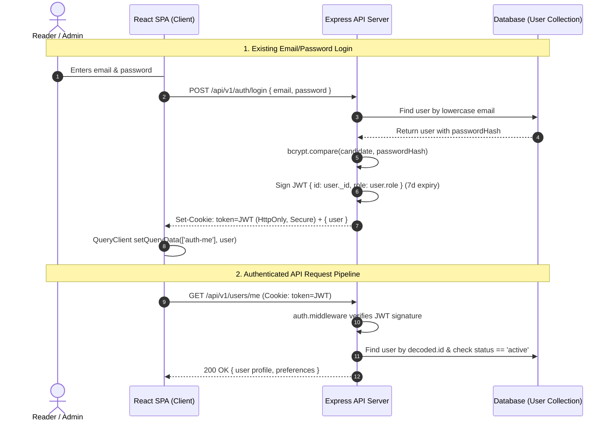
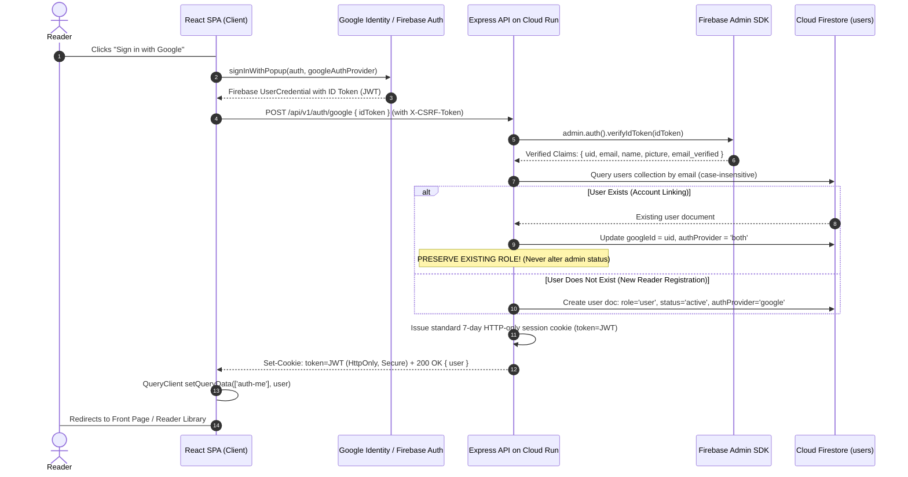

# Authentication & Security Architecture Design

**Project:** The News Report — Firebase Migration  
**Document ID:** `AUTHENTICATION_SECURITY_DESIGN.md`  
**Phase:** Phase 1 — Baseline Audit & Firebase Foundation  
**Audited Source Directory:** `backend/src/controllers/auth.controller.ts`, `backend/src/middleware/auth.middleware.ts`, `frontend/src/context/AuthContext.tsx`  
**Execution Timestamp:** 2026-11-02  

---

## 1. Executive Summary

The production application implements a security-hardened authentication system combining **bcrypt password hashing**, **signed JSON Web Tokens (JWT)** transmitted via **HTTP-only, SameSite cookies**, and **double-submit cookie CSRF defense**. 

This document audits the complete existing authentication and session lifecycle, and designs the integration of the **only authorized new user-facing feature** for the entire migration: **Google Sign-in via Firebase Authentication**.

The design guarantees:
- **Dual Authentication Parity:** Existing email/password registration and login remain 100% active and unmodified.
- **Unified Session Architecture:** Google Sign-in authenticates via Firebase on the client, but issues the exact same secure HTTP-only backend session cookie, preserving role-based access control, CSRF protections, and reader personalization.
- **Strict Role-Based Access Control (RBAC):** Google Sign-in accounts default strictly to the `'user'` role. Administrator privileges are **never** granted automatically.
- **Deterministic Account Linking:** Existing email/password accounts can link a Google identity safely without creating duplicate reader profiles or corrupting engagement histories.

---

## 2. Existing Authentication System Audit

### 2.1 Audit Findings

| Component | Current Implementation | Security Evaluation |
| :--- | :--- | :--- |
| **Password Hashing** | `bcrypt.hash(password, 10)` in `auth.controller.ts` | **Industry Standard:** Adaptive salt rounds, protects credentials against brute-force. |
| **Session Representation** | Signed JWT (`jsonwebtoken`) signed with `env.JWT_SECRET`, expiring in 7 days (`7d`). | **Stateless & Robust:** Payload `{ id, role }` enables rapid middleware authorization. |
| **Cookie Storage** | Cookie named `token` with `httpOnly: true`, `secure: req.secure`, `sameSite: 'lax'` or `'none'`, path `/`. | **XSS Immune:** JavaScript cannot read `document.cookie` for the token. |
| **CSRF Defense** | `csrf.middleware.ts` generates cryptographic token in cookie `csrf-token`. Mutating requests must send matching `X-CSRF-Token` header. | **High Security:** Prevents cross-site request forgery attacks. |
| **Access Control (RBAC)**| `requireRole('admin')` in `auth.middleware.ts` blocks non-admin users with 403 Forbidden. | **Enforced:** Checked on every CMS endpoint. |
| **Content Gating** | `optionalAuthenticate` in `auth.middleware.ts` checks token if present. If absent or invalid, marks `isGated: true` on premium stories. | **Editorial Content Protection:** Enforces subscriber-only gating. |
| **Profile & Preferences** | `/users/me` and `/users/me/preferences` allow updating name, interests, and preferred language (`en`, `te`, `hi`). | **Functional:** Connected to Reader Personalization feed. |

---

## 3. Google Sign-In Architecture & Integration Design

Google Sign-in will be introduced as an additional, frictionless sign-in and registration option on `LoginPage.tsx` and `RegisterPage.tsx`.

### 3.1 Verification and Account Linking Rules

1. **Email Verification Requirement:**
   - The backend checks `decodedToken.email_verified === true`. Google identity tokens for `@gmail.com` and Google Workspace accounts are pre-verified by Google. Unverified emails are rejected with 403 Forbidden.
2. **Account Linking Without Duplication:**
   - The backend executes a lookup in `users` where `email == decodedToken.email.toLowerCase()`.
   - **Case A: Existing Account Found:**
     - The existing reader profile is preserved.
     - Fields updated: `googleId: decodedToken.uid`, `authProvider: 'both'`, `avatar: user.avatar || decodedToken.picture`.
     - **CRITICAL SECURITY RULE:** The user's existing `role` is **never modified**. If an existing user was `'admin'`, they retain `'admin'`. If they were `'user'`, they stay `'user'`.
     - The reader can now log in using either their existing password OR Google Sign-in!
   - **Case B: New Account Created:**
     - A new reader record is created:
       - `name: decodedToken.name || 'Reader'`
       - `email: decodedToken.email.toLowerCase()`
       - `role: 'user'` (**STRICT DEFAULT: NEVER ADMIN**)
       - `status: 'active'`
       - `avatar: decodedToken.picture || ''`
       - `authProvider: 'google'`
       - `googleId: decodedToken.uid`
       - `preferredLanguage: 'en'`
3. **Session Cookie Issuance:**
   - Regardless of whether the user logged in via email/password or Google, the backend calls the exact same `sendAuthToken(req, res, user._id, user.role)` helper.
   - The browser receives the familiar HTTP-only signed session cookie. All subsequent API calls (likes, bookmarks, comments, admin operations) authenticate seamlessly through the existing `auth.middleware.ts` pipeline!

---

## 4. Security & Hardening Safeguards

| Threat Vector | Mitigation Strategy in Design |
| :--- | :--- |
| **Privilege Escalation** | Google Sign-in explicitly sets `role: 'user'` for all new registrations. Administrator privileges cannot be acquired via OAuth; only database administrators can grant the `'admin'` role. |
| **Token Spoofing** | The backend verifies the cryptographically signed Google ID token using the official **Firebase Admin SDK** (`verifyIdToken`), verifying audience, issuer (`https://securetoken.google.com/thenewsreport-2010`), signature, and expiration. |
| **CSRF Exploitation** | The new `POST /api/v1/auth/google` endpoint is protected by the existing `csrfProtection` middleware, requiring the standard `X-CSRF-Token` header. |
| **XSS Token Theft** | Google ID tokens are exchanged immediately on login for HTTP-only cookies; neither the Google token nor the application session JWT is ever stored in `localStorage` or `sessionStorage`. |
| **Account Disabling** | If an administrator disables an abusive account (`status: 'disabled'`), both email/password login and Google sign-in check `user.status === 'disabled'` and reject entry with 403 Forbidden. |

---

## 5. Migration Phase Implementation Boundaries

> [!CAUTION]
> In strict compliance with Phase 1 constraints:
> - **No authentication code has been modified.**
> - **Google Sign-in has not been enabled in the Firebase Console.**
> - **Firebase Client SDK has not been added to dependencies.**
> 
> The above design will be implemented cleanly during **Phase 2 (Authentication Migration)** after user review and approval.

