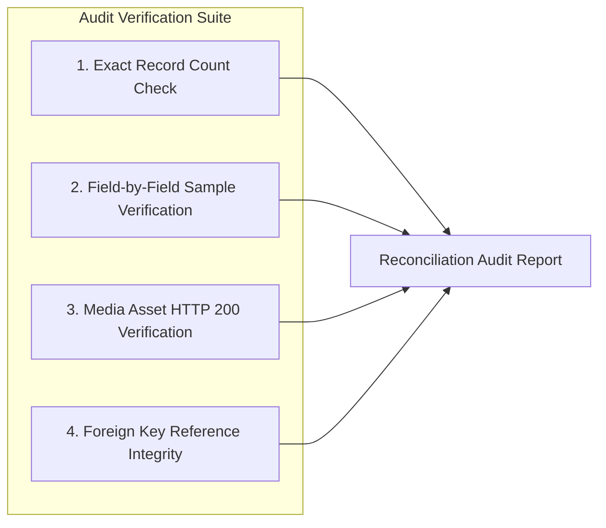

# Data Migration, Reconciliation & Rollback Strategy

**Project:** The News Report — Firebase Migration  
**Document ID:** `DATA_MIGRATION_AND_ROLLBACK.md`  
**Phase:** Phase 1 — Baseline Audit & Firebase Foundation  
**Target Execution Phase:** Phase 4 (Database & Media Migration)  
**Execution Timestamp:** 2026-11-02  

---

## 1. Executive Summary

This document establishes the end-to-end operational protocol for migrating all platform data from **MongoDB Atlas** and **Cloudinary** to **Cloud Firestore** and **Google Cloud Storage**.

Under the non-negotiable project requirements:
- The existing production website and database must remain **completely operational and untouched** throughout the migration.
- Zero production data may be deleted, reset, or overwritten.
- All migration scripts must be deterministic, non-destructive, and safely re-runnable (idempotent).
- A zero-downtime cutover and an instantaneous rollback plan must be prepared before any data is transferred.

---

## 2. High-Level Migration Workflow

```mermaid
flowchart TD
    subgraph Step 1: Backup & Snapshot
        Atlas[(MongoDB Atlas Live)] -->|Read-Only mongodump / JSON Export| BackupStore[(Local / Cloud Storage Backup)]
        Cloudinary[(Cloudinary Media CDN)] -->|Asset Manifest Export| BackupStore
    end

    subgraph Step 2: Transformation Engine
        BackupStore --> Transform[Node.js Migration Worker]
        Transform --> TransformID[Preserve 24-Hex IDs]
        Transform --> Denorm[Denormalize Author, Category, Tags]
        Transform --> CompositeKeys[Generate Composite Keys: Likes, Bookmarks, Votes]
        Transform --> MediaTransfer[Download Cloudinary Assets -> Upload to GCS Bucket]
        Transform --> UrlReplace[Rewrite Content HTML Image URLs]
    end

    subgraph Step 3: Ingestion & Reconciliation
        Transform --> BatchIngest[Firestore Batch Commit (450 docs/batch)]
        BatchIngest --> Firestore[(Target Cloud Firestore)]
        MediaTransfer --> GCS[(Target Cloud Storage)]
        
        Firestore --> Audit[Automated Reconciliation Audit]
        GCS --> Audit
        Atlas -.->|Count & Hash Comparison| Audit
    end

    subgraph Step 4: Verification & Acceptance
        Audit -->|100% Match Verified| StagingValidation[Staging Acceptance Testing]
        StagingValidation --> CutoverDecision{User Approval to Cutover?}
        CutoverDecision -->|Approved| Cutover[Domain Cutover to Firebase Hosting]
        CutoverDecision -->|Rejected / Blocked| Rollback[Instant Rollback: Retain Live Production]
    end
```

---

## 3. Step-by-Step Data Migration Protocol (Phase 4)

### 3.1 Step 1: Source Backup & Immutable Export
1. Prior to any read operation, capture a complete snapshot of MongoDB Atlas using `mongodump` or the automated Atlas snapshot tool.
2. Export JSON dumps of all 10 collections:
   - `users.json`
   - `categories.json`
   - `tags.json`
   - `languages.json`
   - `posts.json`
   - `comments.json`
   - `likes.json`
   - `bookmarks.json`
   - `pollvotes.json`
   - `media.json`
3. Store the export in a timestamped, encrypted backup directory.

### 3.2 Step 2: Data Transformation Rules
The migration script transforms MongoDB BSON documents into Firestore documents according to the specifications in `FIRESTORE_DATA_MODEL.md`:

| Source Collection | Transformation Logic & ID Preservation Strategy |
| :--- | :--- |
| **`categories`** | - Retain MongoDB `_id` string as Firestore Document ID.<br>- Preserve hierarchy: `parent` category ID string.<br>- Set `status: doc.status \|\| 'active'`. |
| **`tags`** | - Retain MongoDB `_id` string as Firestore Document ID.<br>- Preserve `name` and `slug`. |
| **`languages`** | - Retain MongoDB `_id` string or use ISO code (`en`, `te`, `hi`) as Document ID.<br>- Preserve `code`, `isDefault`, `status`. |
| **`users`** | - Retain MongoDB `_id` string as Firestore Document ID.<br>- Preserve `name`, `email`, `passwordHash`, `role`, `preferredLanguage`, `interests`.<br>- Set `authProvider: 'local'`. |
| **`posts`** | - Retain MongoDB `_id` string as Firestore Document ID.<br>- **Denormalize Display Entities:** Inject `{ id, name, slug }` for category, `{ id, name, avatar }` for author, and `{ id, code, name }` for language.<br>- Convert dates to Firestore `Timestamp` objects.<br>- Preserve all 8 format structures (`galleryItems`, `sortedListItems`, `videoDetails`, `audioDetails`, `pollDetails`, `eventDetails`).<br>- Preserve all `translations` array entries. |
| **`comments`** | - Retain MongoDB `_id` string as Firestore Document ID.<br>- Inject denormalized `post: { id, title, slug }` and `user: { id, name, avatar, role }`.<br>- Preserve `content`, `status`, and timestamps. |
| **`likes`** | - **Deterministic Composite ID:** Set Document ID to `${doc.user}_${doc.post}`.<br>- Retain `userId: doc.user`, `postId: doc.post`, `createdAt: doc.createdAt`. |
| **`bookmarks`** | - **Deterministic Composite ID:** Set Document ID to `${doc.user}_${doc.post}`.<br>- Inject denormalized `postSnippet` from matching post document. |
| **`pollVotes`** | - **Deterministic Composite ID:** Set Document ID to `${doc.pollPost}_${doc.user}`.<br>- Retain `pollPost`, `user`, `optionId`, and `createdAt`. |
| **`media`** | - Retain MongoDB `_id` string as Firestore Document ID.<br>- Update `url` and `secureUrl` to point to the new Google Cloud Storage bucket path. |

### 3.3 Step 3: Media Asset Transfer & Content URL Replacement
1. **Asset Migration:**
   - Iterate through all `Media` documents and user `avatar` files.
   - Stream each image/audio/video from Cloudinary into `gs://thenewsreport-2010.firebasestorage.app/media/`.
   - Record mapping in `media-url-mapping.json`:
     `"https://res.cloudinary.com/.../image.jpg" -> "https://storage.googleapis.com/.../image.webp"`
2. **HTML Content Rewriting:**
   - Within `post.content` (TipTap HTML) and `translation.content`, search for all occurrences of Cloudinary URLs matching `media-url-mapping.json` and replace them with the corresponding Cloud Storage URLs.

### 3.4 Step 4: Batch Ingestion into Firestore
- Ingest documents using `firestore.batch()`.
- Group operations into chunks of **450 operations per batch** (safely below Firestore's 500-operation transaction limit).
- Execute sequential batch commits with exponential backoff on transient errors.

---

## 4. Reconciliation & Verification Protocol

Before declaring the data migration complete, the migration worker executes automated reconciliation scripts:



1. **Exact Record Count Audit:**
   - Compare `collection.countDocuments()` in MongoDB vs `collection.count().get()` in Firestore.
   - Counts for `users`, `categories`, `tags`, `languages`, `posts`, `comments`, `likes`, `bookmarks`, `pollVotes`, and `media` must match **100% exactly**.
2. **Sample Record Integrity Check:**
   - Draw 10 random documents from each collection.
   - Compare attributes, format details, translations, and timestamps field-by-field.
3. **Media Delivery Verification:**
   - Execute HTTP `HEAD` requests against every migrated image URL in `posts` and `users`.
   - Verify `200 OK` response code, valid `Content-Type`, and matching byte sizes.
4. **Relational Integrity Verification:**
   - Ensure every `postId` in `comments`, `likes`, and `bookmarks` corresponds to a valid existing document in `posts`.
   - Ensure every `category.id` corresponds to a valid document in `categories`.

---

## 5. Cutover Window & Instantaneous Rollback Strategy

### 5.1 Cutover Window Protocol
1. **Freeze Editorial Publishing:** Schedule a 30-minute maintenance window for the editorial newsroom.
2. **Final Delta Sync:** Run an incremental sync script that captures any comments or likes submitted in the preceding hour.
3. **DNS / Routing Cutover:** Update domain DNS records (`CNAME` / `A` records) to point to Firebase Hosting and Google Cloud Run.
4. **Post-Cutover Smoke Tests:** Execute critical user journeys (front page read, search query, reader login, article bookmark, comment posting, admin CMS edit).

### 5.2 Rollback Protocol (Zero-Risk Guarantee)
If an unforeseen critical failure occurs during cutover:
1. **Instant DNS Reversion:** Immediately re-point DNS records back to the original Render backend and Vercel frontend.
2. **Production Integrity:** Because the original MongoDB Atlas database and Cloudinary account were kept 100% untouched and online throughout, the original production website resumes service instantly with zero data loss.
3. **Post-Mortem & Fix:** Investigate the issue in the isolated Firebase environment without any impact on active news readers.

