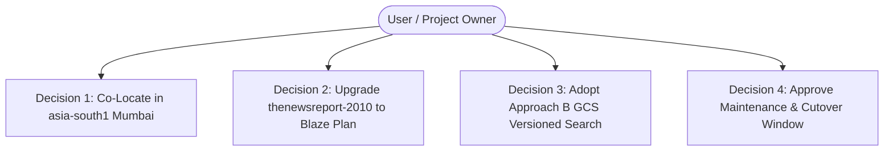

# Final Phase 1 Approval Checklist & Phase 2 Gate Authorization

**Project:** The News Report — Firebase Migration  
**Document ID:** `FINAL_PHASE_1_APPROVAL_CHECKLIST.md`  
**Phase:** Phase 1 — Baseline Audit & Firebase Foundation (Final Gate Checklist)  
**Target Project:** `thenewsreport-2010` (Project Number: `856380333461`)  
**Designated Region:** `asia-south1` (Mumbai, Maharashtra, India)  
**Repository Remote:** `https://github.com/Udayvamsi283/TheNewsReport.git`  
**Original Production Repository:** `TheNews` (Completely Untouched)  
**Execution Timestamp:** 2026-11-02  

---

## 1. Executive Summary

This checklist forms the formal governance gate between **Phase 1 (Baseline Audit & Firebase Foundation)** and **Phase 2 (Firebase Authentication & Security Rules)**. 

In strict adherence to Phase 1 rules:
- **Zero application source code** has been modified.
- **Zero cloud infrastructure** has been provisioned.
- **Billing remains on the free Spark plan**.
- **The live production website and original repository remain 100% untouched.**

The technical audit, architecture blueprint, data modeling, search concurrency design, Indic test specifications, multi-scenario billing calculations, and rollback strategies are fully articulated across 13 comprehensive documents in `docs/firebase-migration/phase-1/`.

---

## 2. Decisions Already Approved & Verified

| # | Decision Item | Verification Status | Source Reference |
| :---: | :--- | :---: | :--- |
| **A-1** | **Repository Isolation** | **VERIFIED** | Local repo remote points to `TheNewsReport`. Original `TheNews` repo is untouched. |
| **A-2** | **Tooling & Dependency Readiness** | **VERIFIED** | Node.js v24.18.0, npm 11.16.0, Git 2.55.0, Firebase CLI 15.34.2 confirmed. Frontend and backend `npm ci` and production builds pass. |
| **A-3** | **Git Exclusions & Credential Safety** | **VERIFIED** | Root `.gitignore` excludes `.firebase/`, debug logs, service account keys, and `.pem`/`.key` files. |
| **A-4** | **100% UI & UX Preservation** | **VERIFIED** | Contractually locked: Zero redesigns, zero layout shifts, zero CSS changes. All 8 post format renderers preserved. |
| **A-5** | **100% Feature Preservation** | **VERIFIED** | All 44 backend API endpoints and features preserved (documented in `FEATURE_PRESERVATION_MATRIX.md`). |
| **A-6** | **Multilingual Scope** | **VERIFIED** | English (`en`), Telugu (`te`), and Hindi (`hi`) supported across all data models and UI contexts. |
| **A-7** | **Authorized New Feature Scope** | **VERIFIED** | Google Sign-in on `LoginPage` and `RegisterPage` is the **only** authorized new feature for the entire migration. |
| **A-8** | **Dual Authentication Parity** | **VERIFIED** | Dual auth model preserving existing bcrypt password hashing alongside Firebase Google Sign-in (`AUTHENTICATION_SECURITY_DESIGN.md`). |
| **A-9** | **Firestore Hex ID Preservation** | **VERIFIED** | Firestore documents retain exact 24-character hexadecimal MongoDB ObjectIDs as document keys (`FIRESTORE_DATA_MODEL.md`). |
| **A-10**| **Dual-Retention Media Migration** | **VERIFIED** | Cloudinary URLs preserved as fallback; media streamed to Cloud Storage bucket with zero client-side breakage (`MEDIA_MIGRATION_PLAN.md`). |
| **A-11**| **Scheduled Publishing Strategy** | **VERIFIED** | Cloud Scheduler invokes `/api/v1/internal/publish-scheduled` every minute using Google IAM OIDC auth (`SCHEDULED_TASKS_AND_TRANSACTIONS.md`). |
| **A-12**| **Zero-Downtime Rollback Strategy** | **VERIFIED** | Dual-run period with dual writes and instant DNS reversion documented in `DATA_MIGRATION_AND_ROLLBACK.md`. |

---

## 3. Decisions Awaiting User Approval

Before authorizing Phase 2 execution, the user must review and provide explicit approval for the following four architectural and financial decisions:

### Decision 1: Regional Footprint Standardized on `asia-south1` (Mumbai, India)
- **Proposed Choice:** Standardize Cloud Firestore (Native Mode), Google Cloud Run, Google Cloud Storage, and Google Cloud Scheduler co-located in `asia-south1` (Mumbai).
- **Technical Rationale:** Delivers lowest network latency (15–35ms) across Indian telecom networks (Jio, Airtel, ACT, BSNL). Co-locating compute, storage, and database eliminates cross-region network egress charges.
- **Clarification:** Technical data residency keeps Firestore documents and Cloud Storage media inside Mumbai data centers. Global Google CDN edges and federated Auth services route globally as described in `FIREBASE_INFRASTRUCTURE_AND_COSTS.md`.
- **Status:** **AWAITING USER APPROVAL**

### Decision 2: Upgrade Firebase Project from Spark to Blaze (Pay-as-you-go)
- **Proposed Choice:** Link a Google Cloud billing account (with valid credit/debit card) to project `thenewsreport-2010` to activate the Blaze plan.
- **Technical Rationale:** Cloud Run (container compute) and Cloud Scheduler (automated cron triggers) strictly require billing enabled on the Google Cloud project, even though expected usage falls within free tier quotas.
- **Cost Implications:**
  - *Expected Baseline (100k pageviews):* **~$1.08 / month (~₹95 INR)**.
  - *Conservative Baseline:* **~$3.00 / month (~₹260 INR)**.
  - *High-Traffic Breaking News Surge (500k pageviews):* **~$17.52 / month (~₹1,500 INR)**.
  - *GST & FX:* Includes 18% Indian GST and estimated 2% foreign exchange card markups.
- **Budget Safeguards:** Establish a **$10.00 USD (~₹850 INR)** monthly budget alert with email notifications at 50%, 80%, and 100% to `thenewsreport2010@gmail.com`, and cap Cloud Run at `--max-instances=3`.
- **Status:** **AWAITING USER APPROVAL**

### Decision 3: Search Architecture — GCS Versioned Snapshot + In-Memory MiniSearch (Approach B)
- **Proposed Choice:** Adopt Approach B (immutable versioned search snapshots in GCS with in-memory `MiniSearch` deserialization on Cloud Run).
- **Concurrency & Reliability Safeguards:**
  - Governed by atomic Firestore transactions on `system/searchMetadata` with concurrency lock (`lockUntil`) and strictly monotonic version counters (`newVersion = currentVersion + 1`).
  - GCS upload occurs before Firestore pointer update; orphaned snapshots are harmless and cleaned up automatically.
  - Cloud Run instances detect newer versions via short TTL (30–60s) and download in background without blocking active searches.
  - If GCS is unreachable during container boot, the container does not crash; it logs an alert and serves HTTP 503 on `/search` while all other 43 API endpoints operate at 100%.
- **Technical Honesty:** Full functional equivalence, ranking fidelity, and latency are subject to empirical execution of the 12 search acceptance test specifications against MongoDB `$text` baseline data in Phase 4.
- **Status:** **AWAITING USER APPROVAL**

### Decision 4: Production Cutover Window & DNS Lowering Policy (Phase 5)
- **Proposed Choice:** Approve the zero-downtime cutover plan: lower DNS TTL to 300 seconds 72 hours prior to cutover, schedule cutover during low-traffic hours (02:00–04:00 IST), and maintain MongoDB sync for 14 days post-cutover.
- **Status:** **AWAITING USER APPROVAL**

---

## 4. Remaining Implementation Risks & Mitigations

| Risk Description | Severity | Likelihood | Technical Mitigation Strategy |
| :--- | :---: | :---: | :--- |
| **Search Ranking & Indic Parity Divergence** | Medium | Low | Execute the 12 formal Indic acceptance tests (ST-01 to ST-12) during Phase 4. If BM25 ranking differs noticeably from MongoDB `$textScore`, tune MiniSearch field boost factors before production deployment. |
| **Cloud Run Idle CPU Throttling on Event Listeners** | High | Resolved | **Mitigated by Approach B:** Eliminated persistent `onSnapshot` listeners in idle containers. Index versions are pulled deterministically from immutable GCS snapshots. |
| **Billing Spike from Traffic Surge or Scraping** | Medium | Low | Capped compute with `--max-instances=3` and `concurrency=80`. Tiered Google Cloud budget alerts at $5, $8, and $10. Cloud Logging exclusions for high-frequency healthchecks. |
| **Container Cold-Start Degradation** | Medium | Low | Snapshot deserialization takes < 100ms. If download fails, container boots with HTTP 503 on search; remaining 43 endpoints function with zero downtime. |
| **Cloudinary Media Orphanage or Link Breakage** | Medium | Low | Dual-retention fallback: Firestore preserves original `cloudinaryUrl` until GCS transfer is checksum-verified. Frontend `` consumes standard URLs seamlessly. |
| **Session Cookie Invalidation Across Domains** | Medium | Low | Route API requests via Firebase Hosting rewrites (`/api/**` $\rightarrow$ Cloud Run), ensuring same-origin cookie transmission without cross-subdomain `SameSite=None` security issues. |

---

## 5. Conditions That Must Pass Before Phase 2 Authorization

The following prerequisites must be met before Phase 2 begins:

1. [x] **Phase 0 Verification:** Environment tools, package-lock files, dependencies, and clean builds passed.
2. [x] **Technical Documentation Complete:** All 13 Phase 1 audit and design documents completed and cross-verified.
3. [x] **Clean Working Tree:** Zero application code modified in `frontend/` or `backend/`.
4. [ ] **User Regional Approval:** User confirms `asia-south1` (Mumbai) for Firestore, Cloud Run, GCS, and Scheduler.
5. [ ] **User Billing Authorization:** User links Google Cloud billing account to `thenewsreport-2010` to enable the Blaze plan.
6. [ ] **User Search Approval:** User confirms Approach B (GCS Versioned Snapshot + MiniSearch) for implementation.
7. [ ] **Explicit Phase 2 Go-Ahead:** User explicitly prompts to begin Phase 2.

---

## 6. Services Requiring Billing (Blaze Plan)

When the Blaze plan is activated, the following services will be governed by consumption-based billing:

| Service | Why Billing Is Required | Monthly Free Allowance Under Blaze | Expected Baseline Bill |
| :--- | :--- | :--- | :---: |
| **Google Cloud Run** | Compute engine hosting Express container | 2M requests, 180k vCPU-s, 360k GiB-s | **$0.00** (Free) |
| **Google Cloud Scheduler** | Automated 1-minute publishing cron | 3 free jobs / billing account globally | **$0.00** (Free) |
| **Google Cloud Storage** | Media archive & versioned search snapshots | *No Always Free in Mumbai.* $0.023/GB/mo from byte 1 | **~$0.15** |
| **Cloud Firestore** | NoSQL database hosting all collections | 50k reads, 20k writes, 1 GB storage per day | **$0.00** (Free) |
| **Firebase Hosting** | Global static asset CDN distribution | 10 GB storage, 10 GB/month transfer | **~$0.75** |
| **Dynamic API Egress** | JSON payloads returned to readers | 100 GB/month free egress from GCP | **$0.00** (Free) |
| **Firebase Auth** | Google Sign-in identity verification | 50,000 monthly active users (MAUs) | **$0.00** (Free) |
| **Cloud Logging** | Application logs & operational diagnostics | 50 GB log ingestion per month | **$0.00** (Free) |

---

## 7. Permanent Non-Negotiable Prohibitions

The following actions **must never be performed without explicit user authorization**:

1. **DO NOT** modify any application source code or configuration files in `frontend/` or `backend/` before authorized.
2. **DO NOT** upgrade project billing or link credit card credentials programmatically.
3. **DO NOT** provision cloud infrastructure (Cloud Run services, Firestore databases, Cloud Storage buckets) before Phase 2.
4. **DO NOT** deploy containers or static assets to live URLs.
5. **DO NOT** touch, query, modify, or delete the original `TheNews` repository or its production database.
6. **DO NOT** proceed to Phase 2 automatically without explicit user authorization.

---

## 8. Gate Authorization Recommendation

### **STATUS: READY AFTER APPROVALS**

**Summary Recommendation:**  
Phase 1 technical discovery, architecture design, and risk mitigations are 100% complete and rigorously documented. The migration plan is sound, safeguards are in place, and the codebase is completely clean. 

Upon receiving explicit user approval for:
1. Region: `asia-south1` (Mumbai)
2. Blaze plan activation on `thenewsreport-2010`
3. Search architecture: Approach B (GCS Versioned Snapshots)
4. Phase 5 cutover window principles

The project is fully prepared to proceed to **Phase 2: Firebase Authentication & Security Rules**.

---

## 9. Search Concurrency and Cloud Run Reliability Sign-off

This section establishes the formal architectural contract and sign-off for search build concurrency, Cloud Run serverless CPU execution, and fault-tolerant error recovery.

### 9.1 Architecture Decisions Approved (Design Consensus)

1. **Regional Co-Location in `asia-south1` (Mumbai):**
   - Cloud Firestore Native mode, Google Cloud Run API compute, Cloud Storage media/search buckets, and Cloud Scheduler triggers will all be co-located in Mumbai.
2. **GCS Versioned Snapshots with In-Memory MiniSearch (Approach B):**
   - Reader searches will be served directly from in-memory `MiniSearch` instances on Cloud Run, populated from immutable GCS snapshots (`search/snapshots/index.v{N}.{buildId}.json`) and versioned via `system/searchMetadata`.
3. **Serverless Cloud Run Request-Based CPU Execution:**
   - Standard Cloud Run request-based CPU allocation ("CPU allocated only during request processing") is approved. The architecture explicitly rejects 24/7 "CPU Always Allocated" instances to avoid $25–$40/month of idle server waste.
4. **Request-Triggered Version Validation with Short In-Memory TTL (30s):**
   - Instances will detect newer versions upon incoming HTTP requests when an in-memory TTL (30 seconds) expires. Persistent idle background loops and Cloud Run Pub/Sub push broadcasts (which cannot broadcast to all instances) are rejected.
5. **Continuous Live Production Website Operation:**
   - The production website and original `TheNews` repository remain 100% untouched and live throughout all phases until Phase 5 DNS cutover.

---

### 9.2 Implementation Requirements (Engineering Contracts for Phase 3 & 4)

#### A. Build Concurrency & Fencing Token Protocol
- **Metadata Schema:** `system/searchMetadata` must store `currentVersion: number`, `publishedBuildId: string`, `indexUrl: string`, `activeBuild: { buildId: string, fencingToken: number, targetVersion: number, lockedAt: Timestamp, lockExpiresAt: Timestamp, workerInstanceId: string } | null`, and `pendingRebuild: boolean`.
- **Lock Acquisition:**
  - Must execute as an atomic Firestore transaction.
  - If `activeBuild` is valid and unexpired (`now() < lockExpiresAt`), set `pendingRebuild = true` and exit gracefully without starting a redundant build.
  - If lock is free or expired (`now() >= lockExpiresAt`), generate cryptographic UUID `buildId`, increment `fencingToken = (activeBuild?.fencingToken || 0) + 1`, compute `targetVersion = currentVersion + 1`, and write `activeBuild` with a 30-second timeout.
- **Lock Ownership Verification Before Publishing:**
  - Before updating `system/searchMetadata`, the worker must execute a verification transaction asserting:
    1. `activeBuild.buildId === this.buildId`
    2. `activeBuild.fencingToken === this.fencingToken`
    3. `now() <= activeBuild.lockExpiresAt`
    4. `this.targetVersion > currentVersion` (monotonicity assertion; prevents version rollback).
  - If any assertion fails, the publish is rejected, the transaction aborts, and the build is discarded.
- **Protection Against Stale/Expired Workers:**
  - If Worker A's build exceeds 30s and Worker B acquires lock token 102, Worker A's subsequent commit is unconditionally rejected due to token mismatch. Worker A can never overwrite Worker B's newer snapshot.
- **Orphaned Snapshot Isolation:**
  - GCS snapshot paths must include the build ID: `search/snapshots/index.v{targetVersion}.{buildId}.json`.
  - Aborted builds leave orphaned GCS files that are never referenced by Firestore. Readers only read from the URL in Firestore. GCS lifecycle rules automatically delete unreferenced snapshots after 14 days.
- **Simultaneous Article Edits:**
  - When two journalists save articles simultaneously, the second edit sets `pendingRebuild = true`. Upon completion of the first build, the worker triggers an immediate follow-up check/build to index the second article cleanly.

#### B. Cloud Run CPU Allocation & Instance Lifecycle
- **Container Bootstrap (Cold Start):**
  - Express initialization reads `system/searchMetadata` and downloads the active GCS snapshot before opening the HTTP port. If GCS is reachable, search is immediately hot.
- **Post-Idle Request Processing:**
  - When an idle instance wakes on an incoming HTTP request, it checks `now() - lastVersionCheckTimestamp > 30s`. If expired, it queries `system/searchMetadata` (~5ms overhead).
- **Stale Index Refresh:**
  - When `currentVersion > cachedVersion` is detected, the instance serves incoming searches from its current cached index without blocking, while downloading and parsing the new snapshot within the active request context. The in-memory reference `this.searchIndex` is swapped atomically.
- **Transient GCS Outages:**
  - If snapshot download fails, catch block logs an alert, backs off the version check for 10 seconds, and continues serving from the cached index.

#### C. Error Handling & Fault Isolation
- **Stale Results vs HTTP 503:**
  - **Serve Stale Results (HTTP 200):** Whenever a valid prior index exists in memory and a newer snapshot cannot be downloaded.
  - **Return HTTP 503:** Only when **NO** valid index is loaded in memory (e.g. cold-start GCS failure).
- **Container Crash Prevention:**
  - Search initialization or snapshot fetch errors must **never crash the Node.js process** or fail `/health`.
- **Endpoint Decoupling:**
  - Search service failures must remain isolated to `/api/v1/public/search`. All other 43 API endpoints (news articles, categories, profiles, authentication) must query Firestore directly and remain operational.
- **Self-Healing Recovery:**
  - Once GCS/Firestore connectivity is restored, the next request detects `searchReady === false` or `cachedVersion < currentVersion`, loads the snapshot, and transitions to normal operation without container restart.

---

### 9.3 Tests Still Pending (Empirical Phase 4 Validation)

The following tests are **formal test specifications** that must be executed and passed during Phase 4 implementation before any staging or production cutover:

1. **Indic & Multilingual Acceptance Suite (ST-01 to ST-12):**
   - Benchmark MiniSearch BM25 results against original MongoDB Atlas `$text` queries across English, Telugu, and Hindi datasets. Compare document IDs, top-5 rank correlation, total counts, and pagination.
2. **Concurrency & Fencing Token Stress Test:**
   - Execute parallel automated publishing scripts simulating simultaneous article saves. Verify that lock contention queues follow-up rebuilds, expired workers are rejected by fencing tokens, and zero version rollbacks occur.
3. **Cloud Run Cold-Start & Memory Benchmark:**
   - Measure actual container cold-start duration and memory footprint during GCS snapshot deserialization on Cloud Run (verifying < 100ms deserialization and < 20MB RAM usage).
4. **Endpoint Decoupling & Fault Injection Test:**
   - Inject network faults simulating GCS outage during cold start. Verify that `/api/v1/public/search` returns HTTP 503 while all other 43 API endpoints return HTTP 200 with normal database responses.

