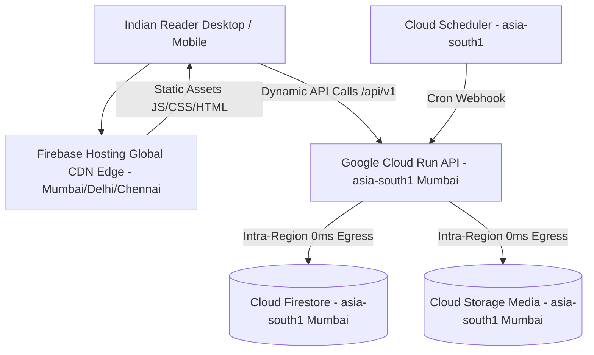

# Google Cloud & Firebase Foundation, Regions & Cost Architecture

**Project:** The News Report — Firebase Migration  
**Document ID:** `FIREBASE_INFRASTRUCTURE_AND_COSTS.md`  
**Phase:** Phase 1 — Baseline Audit & Firebase Foundation  
**Audited Project ID:** `thenewsreport-2010` (Project Number: `856380333461`)  
**Execution Timestamp:** 2026-11-02  

---

## 1. Executive Summary

This document evaluates the Google Cloud and Firebase infrastructure topology for **The News Report**. It assesses geographical regions for latency and data residency for the Indian readership, analyzes the transition from the free Spark plan to the Blaze (Pay-as-you-go) plan, and provides a realistic monthly cost model.

> [!IMPORTANT]
> - Firestore database location selection is **permanent and irreversible** once created.
> - In strict adherence to Phase 1 rules, **billing has NOT been upgraded** and **NO cloud resources have been provisioned**. This document serves as the recommendation for user review and approval.

---

## 2. Regional Topology Evaluation for Indian Audience

The primary readership for The News Report is based in India (consuming English, Telugu, and Hindi editorial dispatches). Selecting an optimal regional footprint minimizes Time to First Byte (TTFB) and network latency.

### Regional Comparison

| Region Identifier | Physical Location | Cloud Run | Firestore | Cloud Storage | Cloud Scheduler | Round-Trip Latency (India) | Evaluation |
| :--- | :--- | :---: | :---: | :---: | :---: | :---: | :--- |
| **`asia-south1`** | **Mumbai, India** | **Yes** | **Yes** | **Yes** | **Yes** | **15 – 35 ms** | **RECOMMENDED PRIMARY.** Lowest latency across Indian ISPs, complete feature parity, mature multi-zone resiliency. |
| `asia-south2` | Delhi, India | Yes | Yes | Yes | Yes | 20 – 45 ms | Viable secondary, but Firestore default regional multi-zone is established in Mumbai. |
| `asia-southeast1` | Singapore | Yes | Yes | Yes | Yes | 65 – 110 ms | Acceptable international fallback, but introduces unnecessary international network hops. |
| `us-central1` | Iowa, USA | Yes | Yes | Yes | Yes | 180 – 260 ms | Unacceptable for newsroom latency and regional content delivery. |

### Architectural Recommendation: Co-Located `asia-south1` (Mumbai)
- **Firestore Location:** `asia-south1`
- **Cloud Run Deployment:** `asia-south1`
- **Cloud Storage Bucket:** `asia-south1`
- **Cloud Scheduler Job:** `asia-south1`
- **Firebase Hosting:** Global Anycast CDN (automatically routes Indian traffic to nearest edge points of presence in Mumbai, Delhi, Chennai, and Hyderabad).
- **Network Egress Optimization:** Placing Cloud Run, Firestore, and Cloud Storage in the exact same region (`asia-south1`) eliminates cross-region network egress charges for intra-service database and media operations ($0.00/GB intra-region bandwidth).

---

## 3. Plan & Billing Analysis: Spark vs. Blaze

The project is currently on the free **Spark plan**.

### 3.1 Service Requirements Demanding the Blaze Plan
While Firestore, Storage, and Hosting offer generous free quotas, the target architecture **requires upgrading to the Blaze (Pay-as-you-go) plan** prior to Phase 2 for the following technical reasons:
1. **Google Cloud Run:** Cloud Run is a Google Cloud compute product that strictly requires billing enabled on the Google Cloud project to deploy containers, even though usage falls within Cloud Run's generous monthly free tier.
2. **Cloud Scheduler:** Requires an active billing account to configure automated cron triggers.
3. **Outbound Network Calls:** Cloud Functions and certain background integrations require Blaze to make external network connections.

---

## 4. Recalculated Monthly Cost Estimates & Multi-Scenario Models

*Traffic Baseline: 25,000 monthly active readers, 100,000 monthly page views, 1,000 published articles, 5GB media photography archive.*

### 4.1 Planning Assumptions & Regional Free Tier Rules
1. **Separation of Hosting vs. Dynamic Egress:**
   - **Firebase Hosting Transfer:** Serves static frontend assets (`index.html`, JS chunks, CSS, static icons).
   - **Dynamic API Egress:** Covers JSON payload responses returned by Cloud Run (`/api/v1/*`).
   - These are separate traffic flows and are not double-counted.
2. **Cloud Storage Regional Nuance in Mumbai:**
   - Google Cloud's 5 GB-months Always Free tier applies **only** to US regions (`us-east1`, `us-central1`, `us-west1`). In `asia-south1` (Mumbai), Standard storage is billed from byte 1 at **$0.023 / GB / month**.
3. **Cloud Run & Firestore Free Tiers:** Apply globally (2M requests, 180k vCPU-s for Cloud Run; 50k reads/day for Firestore).
4. **Cloud Scheduler Free Tier:** First 3 jobs per billing account are 100% free globally, regardless of execution frequency.
5. **MAU Reconciliation:** 25,000 monthly active readers visit anonymously. Only signed-in readers (~20% = 5,000 MAUs) count toward Firebase Auth, well within the 50,000 free monthly quota.

### 4.2 Multi-Scenario Cost Breakdown

| Service Tier / Cost Item | Free Allowance Details | Scenario 1: Expected Baseline (100k pageviews, 25k readers) | Scenario 2: Conservative Baseline (100k pageviews, lower cache hit rate) | Scenario 3: High-Traffic Surge (500k pageviews, breaking news) |
| :--- | :--- | :---: | :---: | :---: |
| **Firebase Hosting (Transfer)** | 10 GB/mo transfer free globally. $0.15/GB thereafter. | 15 GB transfer (5 GB billable) $\rightarrow$ **$0.75** | 25 GB transfer (15 GB billable) $\rightarrow$ **$2.25** | 100 GB transfer (90 GB billable) $\rightarrow$ **$13.50** |
| **Google Cloud Run (Compute)** | 2M requests, 180k vCPU-s, 360k GiB-s free globally. | 125k requests, 5k vCPU-s $\rightarrow$ **$0.00** (Free) | 200k requests, 10k vCPU-s $\rightarrow$ **$0.00** (Free) | 650k requests, 35k vCPU-s $\rightarrow$ **$0.00** (Free) |
| **Cloud Firestore (Operations)** | 50k reads/day (1.5M/mo), 20k writes/day, 1 GB storage free. | 500k reads, 12k writes $\rightarrow$ **$0.00** (Free) | 850k reads, 20k writes $\rightarrow$ **$0.00** (Free) | 2.5M reads (1M billable @ $0.06/100k) $\rightarrow$ **$0.60** |
| **Cloud Storage (`asia-south1`)** | *No Always Free in Mumbai.* Billed from byte 1 @ $0.023/GB/mo. | 5 GB media @ $0.023 + ops $\rightarrow$ **$0.15** | 8 GB media @ $0.023 + ops $\rightarrow$ **$0.25** | 15 GB media @ $0.023 + ops $\rightarrow$ **$0.50** |
| **Cloud Scheduler (Automated Cron)**| **3 free jobs per billing account per month.** Frequency unbilled. | 1 job (every 1 min) $\rightarrow$ **$0.00** (Free) | 1 job (every 1 min) $\rightarrow$ **$0.00** (Free) | 1 job (every 1 min) $\rightarrow$ **$0.00** (Free) |
| **Firebase Authentication** | 50,000 MAUs free per month globally. | 5,000 MAUs $\rightarrow$ **$0.00** (Free) | 10,000 MAUs $\rightarrow$ **$0.00** (Free) | 25,000 MAUs $\rightarrow$ **$0.00** (Free) |
| **Dynamic API Egress** | First 100 GB/mo internet egress from GCP is free under general egress tiers. | ~10 GB egress $\rightarrow$ **$0.00** (Free) | ~20 GB egress $\rightarrow$ **$0.00** (Free) | ~60 GB egress $\rightarrow$ **$0.00** (Free) |
| **Cloud Logging & Monitoring** | 50 GB log ingestion per month free. | ~1.5 GB logs $\rightarrow$ **$0.00** (Free) | ~3.0 GB logs $\rightarrow$ **$0.00** (Free) | ~8.0 GB logs $\rightarrow$ **$0.00** (Free) |
| **SUBTOTAL (USD)** | — | **$0.90 / month** | **$2.50 / month** | **$14.60 / month** |
| **Indian 18% GST (Taxes)** | Added to all cloud service invoices in India without GSTIN. | **$0.16** | **$0.45** | **$2.63** |
| **Estimated Card FX Markup (2%)** | For non-INR processing cards. | **$0.02** | **$0.05** | **$0.29** |
| **TOTAL ESTIMATED MONTHLY BILL** | — | **~$1.08 / month (~₹95 INR)** | **~$3.00 / month (~₹260 INR)** | **~$17.52 / month (~₹1,500 INR)** |

> [!NOTE]
> The figures above are **planning estimates based on current published Google Cloud pricing models**, not guaranteed fixed invoices. Actual monthly charges depend on traffic spikes, reader caching behavior, and media upload volumes.

---

## 5. Cost-Control & Safety Governance Measures

Google Cloud Billing operates on consumption. **Budget alerts are automated email notifications; they do NOT automatically terminate running services or shut down servers.** Hard spending caps do not exist natively in Firebase without custom Cloud Functions that programmatically disable billing (which risks service disruption).

To enforce practical financial safeguards without service interruption:
1. **Cloud Run Concurrency & Max Instances:**
   - Configure `--max-instances=3` with `concurrency=80`.
   - Prevents run-away auto-scaling from traffic floods or malicious scraping. Three instances can process up to 240 concurrent requests (~14,000 requests/minute), perfectly sizing compute for the newsroom.
2. **Tiered Budget Notifications:**
   - Configure a Google Cloud Budget of **$10.00 USD (~₹850 INR)** with alert notifications sent to `thenewsreport2010@gmail.com` at **50% ($5.00)**, **80% ($8.00)**, and **100% ($10.00)**.
3. **Cloud Logging Exclusion Filters:**
   - Exclude high-frequency routine healthcheck endpoints (`/health` and `/api/v1/internal/publish-scheduled`) from Cloud Logging to eliminate log volume inflation.
4. **Browser & CDN Caching Directives:**
   - Configure immutable caching headers on all Cloud Storage media (`Cache-Control: public, max-age=31536000, immutable`) to minimize billable bucket operations.

> [!CAUTION]
> While these safeguards significantly restrict exposure to runaway costs, **no cloud configuration can guarantee an absolute zero-overage bill**. Monitoring billing dashboards remains an ongoing operational duty.

---

## 6. Regional Availability & Technical Data Residency

### 6.1 Services Co-Located in `asia-south1` (Mumbai)
- **Cloud Firestore Native Database:** Primary data center in Mumbai across 3 availability zones (`asia-south1-a`, `asia-south1-b`, `asia-south1-c`).
- **Google Cloud Run:** API service instances execute within data centers in Mumbai.
- **Google Cloud Storage:** Media buckets and versioned search index snapshots reside in Mumbai.
- **Google Cloud Scheduler:** Cron trigger infrastructure runs in Mumbai.

### 6.2 Global Google Infrastructure Components
- **Firebase Authentication:** User authentication state and session validation operate via Google's global federated identity infrastructure; user profile documents remain in Firestore Mumbai.
- **Firebase Hosting CDN:** Static frontend assets are cached globally across Google's Anycast edge Points of Presence (PoPs) to optimize delivery worldwide, including Indian edge nodes in Mumbai, Delhi, Chennai, and Hyderabad.
- **Google Analytics / Telemetry:** If activated in frontend builds, analytics events route to Google's global analytics ingestion pipeline.
- **Third-Party CDN Dependencies:** Any frontend fonts, icons, or external libraries bundled via npm or external CDNs route according to their respective providers.

> [!NOTE]
> This section describes technical infrastructure topology. No statutory or regulatory legal compliance certifications (such as RBI localization or DPDP formal audits) are claimed or implied.

