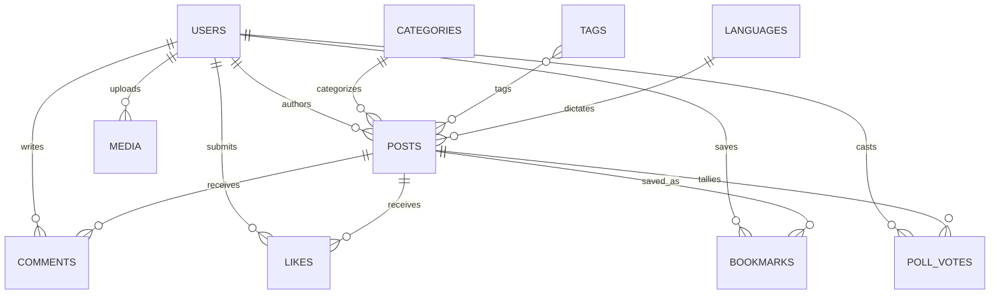

# Cloud Firestore Data Architecture & Schema Design

**Project:** The News Report — Firebase Migration  
**Document ID:** `FIRESTORE_DATA_MODEL.md`  
**Phase:** Phase 1 — Baseline Audit & Firebase Foundation  
**Audited Source Directory:** `D:\UDAY\Projects\TheNewsReport\backend\src\models`  
**Execution Timestamp:** 2026-11-02  

---

## 1. Executive Summary

This document specifies the complete target **Cloud Firestore** schema designed to replace the existing **MongoDB Atlas** database. The architecture guarantees:
- **100% Data Model Fidelity:** Preserves every article attribute, format-specific data structure, multilingual translation, taxonomy hierarchy, user profile, and reader engagement state.
- **Strict Adherence to Firestore Constraints:** Enforces zero unbounded arrays, maintains document sizes far below the 1MB Firestore threshold, and avoids hotspot write contention.
- **ID Preservation Strategy:** Retains existing 24-character hexadecimal MongoDB `_id` strings as Firestore Document IDs to guarantee that existing URLs, internal foreign references, and media associations remain unbroken.
- **Relational Integrity Without Joins:** Because Firestore does not support `.populate()`, essential display attributes (`author`, `category`, `language`, `tags`) are selectively denormalized into article documents at write time.

---

## 2. Collection Architecture & Relationship Overview

---

## 3. Detailed Collection Specifications

### 3.1 Collection: `users`
- **Purpose:** Stores reader and administrator accounts, profile preferences, and authentication metadata.
- **Document ID Strategy:** Existing 24-character hex ID (e.g. `654f...`) during migration; 20-character auto-generated Firestore ID or Firebase Auth UID for new sign-ups.

| Field Name | Type | Required | Description & Constraints |
| :--- | :--- | :---: | :--- |
| `name` | string | Yes | Reader or journalist full name (2–100 chars). |
| `email` | string | Yes | Unique lowercase email address. Single-field index. |
| `passwordHash` | string | No | Bcrypt hash. Optional for pure Google Sign-in accounts. |
| `avatar` | string | No | Public HTTPS URL of user profile image. |
| `avatarPublicId` | string | No | Storage path/object name for deletion lifecycle. |
| `role` | string | Yes | `'user'` \| `'admin'`. Enforces RBAC. |
| `preferredLanguage`| string | Yes | ISO code: `'en'` \| `'te'` \| `'hi'`. Defaults to `'en'`. |
| `interests` | array<string> | No | Array of category IDs for personalized feed. |
| `status` | string | Yes | `'active'` \| `'disabled'`. Disabled accounts blocked. |
| `authProvider` | string | Yes | `'local'` \| `'google'` \| `'both'`. Tracks auth origin. |
| `googleId` | string | No | Unique Google Subject ID from Firebase ID token. |
| `createdAt` | timestamp | Yes | Account registration timestamp. |
| `updatedAt` | timestamp | Yes | Last profile update timestamp. |

- **Indexes Required:**
  - `email` (Ascending, Unique enforcement via transaction or lookup doc).
  - `role, status, createdAt DESC` (Composite for Admin User Management).

---

### 3.2 Collection: `posts`
- **Purpose:** The core editorial collection containing news articles, multimedia dispatches, format data, and translations.
- **Document ID Strategy:** Existing 24-character hex ID (e.g. `6712a...`) preserved.

| Field Name | Type | Required | Description & Constraints |
| :--- | :--- | :---: | :--- |
| `title` | string | Yes | Primary editorial headline. |
| `slug` | string | Yes | Unique URL slug (lowercase, hyphens). |
| `summary` | string | No | Standfirst or summary paragraph. |
| `content` | string | No | Sanitized TipTap HTML content. |
| `author` | map | Yes | Denormalized author: `{ id: string, name: string, avatar: string }`. |
| `category` | map | Yes | Denormalized category: `{ id: string, name: string, slug: string }`. |
| `tags` | array<map> | Yes | Array of `{ id: string, name: string, slug: string }`. |
| `language` | map | Yes | Primary language: `{ id: string, code: string, name: string }`. |
| `postFormat` | string | Yes | `'article'` \| `'gallery'` \| `'sorted_list'` \| `'table_of_contents'` \| `'video'` \| `'audio'` \| `'poll'` \| `'event'`. |
| `status` | string | Yes | `'draft'` \| `'published'` \| `'scheduled'` \| `'trashed'`. |
| `publishedAt` | timestamp | No | Date and time published. |
| `scheduledAt` | timestamp | No | Future publication target date. |
| `isFullWidth` | boolean | Yes | Visual layout flag. Defaults to `false`. |
| `registeredOnly`| boolean | Yes | Content gate flag. If `true`, requires login. |
| `isFeatured` | boolean | Yes | Editorial hero / lead curation flag. |
| `isBreaking` | boolean | Yes | Live breaking news ticker alert flag. |
| `externalUrl` | string | No | Optional external syndicated source link. |
| `featuredImage` | map | No | `{ url: string, publicId?: string, alt?: string, caption?: string, width?: number, height?: number }`. |
| `images` | array<map> | No | Array of secondary media items `{ url, publicId, alt, caption }`. |
| `seo` | map | No | `{ metaTitle, metaDescription, canonicalUrl, ogTitle, ogDescription, ogImage, keywords: string[] }`. |
| `faq` | array<map> | No | Structured schema items: `[{ question: string, answer: string }]`. |
| `translations` | array<map> | No | Localized dispatches: `[{ languageId, languageCode, title, slug, summary, content, seo }]`. |
| `galleryItems` | array<map> | No | Format: `gallery` items: `[{ image, title, description, order }]`. |
| `sortedListItems`| array<map> | No | Format: `sorted_list` items: `[{ itemNumber, title, content, image }]`. |
| `videoDetails` | map | No | Format: `video`: `{ videoUrl, embedUrl, provider, duration }`. |
| `audioDetails` | map | No | Format: `audio`: `{ audioUrl, coverImage, duration, artist }`. |
| `pollDetails` | map | No | Format: `poll`: `{ question, options: [{ id, text, votes: number }], startTime, endTime }`. |
| `eventDetails` | map | No | Format: `event`: `{ startDate, endDate, locationName, address, mapUrl, eventUrl }`. |
| `previewToken` | string | No | Random UUID for unauthenticated editorial previews. |
| `views` | number | Yes | Total article views. Atomic increment. |
| `likeCount` | number | Yes | Total reader likes. Atomic increment. |
| `commentCount` | number | Yes | Total visible comments. Atomic increment. |
| `createdAt` | timestamp | Yes | Creation timestamp. |
| `updatedAt` | timestamp | Yes | Last update timestamp. |

- **Composite Indexes Required:**
  - `status ASC, publishedAt DESC` (Wire feeds, sitemap, public discovery).
  - `status ASC, isFeatured DESC, publishedAt DESC` (Homepage hero curation).
  - `status ASC, isBreaking DESC, publishedAt DESC` (Breaking news alerts).
  - `status ASC, category.slug ASC, publishedAt DESC` (Category archive pages).
  - `status ASC, postFormat ASC, publishedAt DESC` (Video dispatches archive).
  - `status ASC, views DESC, publishedAt DESC` (Trending dispatches).
  - `status ASC, scheduledAt ASC` (Cloud Scheduler automated publisher).
  - `slug ASC` (Single field index for slug lookups).

---

### 3.3 Collection: `categories`
- **Purpose:** Hierarchical taxonomy for news sections and regional desks.
- **Document ID Strategy:** Existing 24-character hex ID preserved.

| Field Name | Type | Required | Description |
| :--- | :--- | :---: | :--- |
| `name` | string | Yes | Category display name (e.g. "International"). |
| `slug` | string | Yes | Unique URL slug (e.g. "international"). |
| `description` | string | No | Editorial scope description. |
| `image` | string | No | Category header banner image URL. |
| `parent` | string | No | Parent category ID or `null` for root categories. |
| `status` | string | Yes | `'active'` \| `'inactive'`. |
| `articleCount` | number | No | Cached published article counter. |
| `createdAt` | timestamp | Yes | Creation timestamp. |
| `updatedAt` | timestamp | Yes | Last update timestamp. |

- **Indexes Required:**
  - `slug ASC` (Unique lookup).
  - `status ASC, name ASC` (Public navigation listing).

---

### 3.4 Collection: `tags`
- **Purpose:** Flat editorial keyword taxonomy.
- **Document ID Strategy:** Existing 24-character hex ID preserved.

| Field Name | Type | Required | Description |
| :--- | :--- | :---: | :--- |
| `name` | string | Yes | Unique tag label (e.g. "Semiconductors"). |
| `slug` | string | Yes | Unique URL slug (e.g. "semiconductors"). |
| `createdAt` | timestamp | Yes | Creation timestamp. |
| `updatedAt` | timestamp | Yes | Last update timestamp. |

---

### 3.5 Collection: `languages`
- **Purpose:** Multilingual configuration table.
- **Document ID Strategy:** ISO language code (`en`, `te`, `hi`) or original hex ID.

| Field Name | Type | Required | Description |
| :--- | :--- | :---: | :--- |
| `name` | string | Yes | Language name (e.g. "Telugu"). |
| `code` | string | Yes | ISO code: `'en'`, `'te'`, `'hi'`. |
| `isDefault` | boolean | Yes | Flag for platform default (`en`). |
| `status` | string | Yes | `'active'` \| `'inactive'`. |
| `createdAt` | timestamp | Yes | Creation timestamp. |
| `updatedAt` | timestamp | Yes | Last update timestamp. |

---

### 3.6 Collection: `comments`
- **Purpose:** Reader commentary on news dispatches.
- **Document ID Strategy:** Existing 24-character hex ID preserved.

| Field Name | Type | Required | Description |
| :--- | :--- | :---: | :--- |
| `postId` | string | Yes | Target post ID. |
| `post` | map | Yes | Denormalized: `{ id: string, title: string, slug: string }`. |
| `userId` | string | Yes | Author user ID. |
| `user` | map | Yes | Denormalized: `{ id: string, name: string, avatar: string, role: string }`. |
| `content` | string | Yes | Sanitized comment text (max 1,000 characters). |
| `status` | string | Yes | `'visible'` \| `'hidden'` \| `'deleted'`. |
| `createdAt` | timestamp | Yes | Comment submission timestamp. |
| `updatedAt` | timestamp | Yes | Moderation update timestamp. |

- **Composite Indexes Required:**
  - `postId ASC, status ASC, createdAt DESC` (Public article comments feed).
  - `status ASC, createdAt DESC` (Admin moderation queue).

---

### 3.7 Collection: `likes`
- **Purpose:** Reader article appreciation records.
- **Document ID Strategy:** **Deterministic Composite Key:** `${userId}_${postId}`.
  - *Architectural Rationale:* Guaranteeing strictly one like per user per article in Firestore without composite unique index support is achieved by setting the document ID to `${userId}_${postId}`. Creating or deleting a like becomes an atomic, idempotent document write!

| Field Name | Type | Required | Description |
| :--- | :--- | :---: | :--- |
| `userId` | string | Yes | Liking reader ID. |
| `postId` | string | Yes | Liked article ID. |
| `createdAt` | timestamp | Yes | Timestamp of like action. |

- **Indexes Required:**
  - `userId ASC, createdAt DESC` (Reader's liked articles library `/liked`).
  - `postId ASC` (Count aggregation / verification).

---

### 3.8 Collection: `bookmarks`
- **Purpose:** Reader saved articles library.
- **Document ID Strategy:** **Deterministic Composite Key:** `${userId}_${postId}`.

| Field Name | Type | Required | Description |
| :--- | :--- | :---: | :--- |
| `userId` | string | Yes | Saving reader ID. |
| `postId` | string | Yes | Bookmarked article ID. |
| `postSnippet` | map | Yes | Denormalized snippet: `{ id, title, slug, summary, featuredImage, publishedAt, category }`. Eliminates N+1 lookups when loading reader's saved library. |
| `createdAt` | timestamp | Yes | Timestamp of bookmark action. |

- **Indexes Required:**
  - `userId ASC, createdAt DESC` (Reader's saved articles library `/saved`).

---

### 3.9 Collection: `pollVotes`
- **Purpose:** Individual reader ballots on interactive poll articles.
- **Document ID Strategy:** **Deterministic Composite Key:** `${postId}_${userId}`.
  - *Architectural Rationale:* Ensures a user can vote exactly once per poll. An attempt to create a document that already exists in a transaction immediately triggers duplicate vote rejection!

| Field Name | Type | Required | Description |
| :--- | :--- | :---: | :--- |
| `postId` | string | Yes | Target poll article ID. |
| `userId` | string | Yes | Voting reader ID. |
| `optionId` | string | Yes | Selected poll option ID string. |
| `createdAt` | timestamp | Yes | Timestamp of ballot submission. |

---

### 3.10 Collection: `media`
- **Purpose:** Newsroom media library cataloging all photography, audio dispatches, and video assets.
- **Document ID Strategy:** Existing 24-character hex ID preserved.

| Field Name | Type | Required | Description |
| :--- | :--- | :---: | :--- |
| `publicId` | string | Yes | Storage object name / path (e.g. `the-news/images/photo_123`). |
| `resourceType` | string | Yes | `'image'` \| `'video'` \| `'audio'` \| `'document'`. |
| `url` | string | Yes | Public HTTPS CDN delivery URL. |
| `secureUrl` | string | Yes | Secure HTTPS CDN delivery URL. |
| `filename` | string | Yes | Stored file name. |
| `originalFilename` | string | Yes | Original uploaded file name. |
| `mimeType` | string | Yes | MIME type (e.g. `image/webp`). |
| `bytes` | number | Yes | Asset size in bytes. |
| `width` | number | No | Image width in pixels. |
| `height` | number | No | Image height in pixels. |
| `duration` | number | No | Audio/video duration in seconds. |
| `alt` | string | No | Accessibility alt text. |
| `caption` | string | No | Editorial photo caption. |
| `folder` | string | Yes | Folder grouping (defaults to `the-news/images`). |
| `uploadedBy` | map | Yes | `{ id: string, name: string }`. |
| `createdAt` | timestamp | Yes | Upload timestamp. |
| `updatedAt` | timestamp | Yes | Last metadata modification timestamp. |

- **Indexes Required:**
  - `resourceType ASC, createdAt DESC` (Media library filter by type).
  - `createdAt DESC` (Media library default chronological view).

---

## 4. Document Size Limits & Unbounded Array Prevention

Firestore enforces a strict hard limit of **1 Megabyte (1,048,576 bytes)** per document. 
- **Article Content Safety:** The largest editorial investigations with embedded HTML content typically average 15KB to 60KB. Even articles with 50 FAQ items and 3 comprehensive translations will not exceed 250KB, well within safe operational boundaries.
- **Engagement Isolation:** Readers' comments, likes, and poll votes are **never stored as arrays within the article document**. Storing comments or likes inside `posts` would cause unbounded document growth and write contention limits (1 write/second per document). Isolating them into independent collections (`comments`, `likes`, `pollVotes`) guarantees unbounded scalability.

