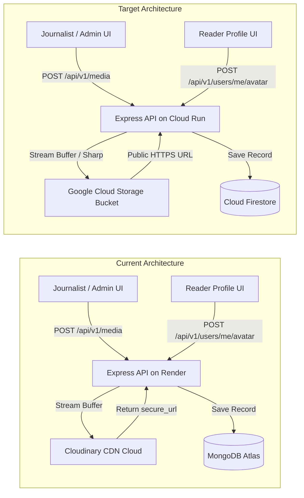
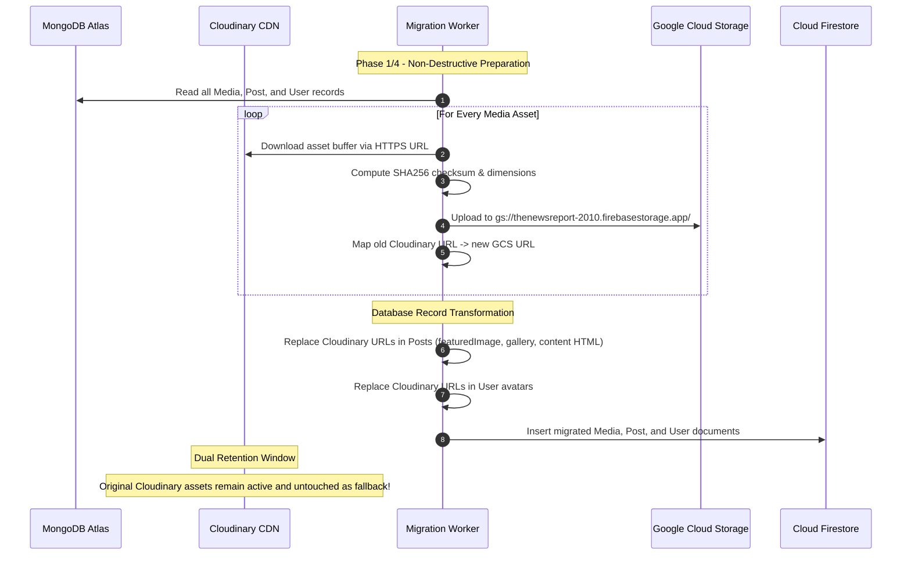

# Media Migration & Cloud Storage Architecture Plan

**Project:** The News Report — Firebase Migration  
**Document ID:** `MEDIA_MIGRATION_PLAN.md`  
**Phase:** Phase 1 — Baseline Audit & Firebase Foundation  
**Audited Source Directory:** `backend/src/config/cloudinary.ts`, `backend/src/controllers/media.controller.ts`, `frontend/src/components/public/ArticleCard.tsx`  
**Execution Timestamp:** 2026-11-02  

---

## 1. Executive Summary

The production website currently utilizes **Cloudinary** for image, audio, and video asset storage, media indexing, and profile photo management. 

Our frontend and backend source code audit reveals a significant architectural advantage: **the frontend performs zero dynamic Cloudinary URL manipulation or proprietary path transformations**. Images are consumed strictly as standard public HTTPS URLs rendered via standard HTML5 `` tags styled with CSS aspect-ratio classes.

This plan details the replacement of Cloudinary with **Google Cloud Storage (Firebase Storage)** within the unified `thenewsreport-2010` project, ensuring 100% preservation of all media associations, dimensions, accessibility metadata, and zero downtime or data loss during the transition.

---

## 2. Existing Cloudinary Architecture Audit



### 2.1 Media Integration Touchpoints

| Module | Source Location | Trigger / Workflow | Operations Performed |
| :--- | :--- | :--- | :--- |
| **Media Library Upload** | `backend/src/controllers/media.controller.ts` | Journalist uploads asset in CMS | - Validates MIME type and 10MB limit.<br>- Calls `uploadToCloudinary` buffer stream into `the-news/images`.<br>- Obtains `secure_url`, `width`, `height`, `bytes`, `format`.<br>- Inserts `Media` document into database. |
| **Media Library Deletion** | `backend/src/controllers/media.controller.ts` | Journalist deletes asset in CMS | - Calls `deleteFromCloudinary(publicId)`.<br>- Deletes `Media` record from database. |
| **Avatar Upload** | `backend/src/controllers/user.controller.ts` | Reader uploads avatar in Profile | - Validates 5MB limit, JPEG/PNG/WebP only.<br>- Streams to `the-news/avatars/avatar_{userId}_{timestamp}`.<br>- Deletes old avatar publicId from Cloudinary.<br>- Updates `user.avatar` and `user.avatarPublicId`. |
| **Avatar Removal** | `backend/src/controllers/user.controller.ts` | Reader clicks "Remove Avatar" | - Calls `deleteFromCloudinary(user.avatarPublicId)`.<br>- Clears avatar fields on user document. |
| **TipTap Editor Insertion** | `frontend/src/components/editor/TipTapEditor.tsx` | Journalist embeds photo in article | - Picks asset from `MediaLibraryModal`.<br>- Embeds `` directly into HTML body. |
| **Article Featured Image** | `backend/src/models/post.model.ts` | Editorial post creation | - Saves `{ url, publicId, alt, caption, width, height }`. |
| **Gallery Format** | `frontend/src/components/public/format-renderers/GalleryRenderer.tsx` | Post format: `gallery` | - Renders array of `{ image: string, title, description, order }`. |

### 2.2 Image Transformation Audit
- **Frontend Audit:** The React SPA relies on CSS Tailwind utility classes (`object-cover`, `aspect-[16/10]`, `aspect-[4/3]`, `rounded-2xl`) for responsive framing. It does **not** inject Cloudinary dynamic URL transformation flags (e.g. `c_fill,w_800,f_auto,q_auto`).
- **Backend Audit:** Cloudinary is currently used as an object store with stream uploading. Automatic format optimization (`f_auto`) can be seamlessly matched or exceeded in Google Cloud Storage by integrating `sharp` during upload to convert imagery to high-efficiency WebP/AVIF.

---

## 3. Target Google Cloud Storage Design

### 3.1 Bucket Configuration
- **Bucket Identifier:** `thenewsreport-2010.firebasestorage.app` (default Firebase Storage bucket) or `thenewsreport-2010-media`.
- **Region:** `asia-south1` (Mumbai) to co-locate with Cloud Run and Firestore for minimum latency to Indian readership.
- **Storage Class:** Standard Storage (optimal for high-frequency public reads).
- **Public Access:** Uniform bucket-level access enabled; public read permissions (`roles/storage.objectViewer` granted to `allUsers` on the `/media` and `/avatars` prefix) to allow high-speed edge delivery.

### 3.2 Directory & Object Key Structure
```text
gs://thenewsreport-2010.firebasestorage.app/
├── media/
│   ├── images/
│   │   └── {timestamp}_{sanitized_filename}.webp
│   ├── audio/
│   │   └── {timestamp}_{sanitized_filename}.mp3
│   └── video/
│       └── {timestamp}_{sanitized_filename}.mp4
└── avatars/
    └── avatar_{userId}_{timestamp}.webp
```

### 3.3 Node.js Cloud Storage Service Implementation
The Cloudinary service in `backend/src/config/cloudinary.ts` will be replaced by `backend/src/services/storage.service.ts` using the official `@google-cloud/storage` SDK:
- **Authentication:** In Cloud Run, uses Application Default Credentials (ADC) via the service's runtime service account. Zero hardcoded secrets or API keys required!
- **Image Optimization Pipeline:** During upload, `sharp` parses the buffer, extracts dimensions (`width`, `height`), optimizes JPEG/PNG to WebP with 85% quality, and streams to Cloud Storage.
- **Delivery URLs:** Constructs standard public HTTPS URLs:
  `https://storage.googleapis.com/thenewsreport-2010.firebasestorage.app/media/images/{filename}.webp`

---

## 4. End-to-End Media Migration Strategy

To ensure zero downtime, unbroken image links, and complete safety, media migration follows a strict dual-retention procedure:



### 4.1 Step-by-Step Execution Plan (Phase 4)
1. **Asset Inventory Extraction:** Query all existing records in MongoDB:
   - All `Media` documents (`url`, `secureUrl`, `publicId`).
   - All `Post` documents (`featuredImage.url`, `images[].url`, `galleryItems[].image`, `audioDetails.coverImage`, and embedded `` tags in `content`).
   - All `User` documents (`avatar`, `avatarPublicId`).
2. **Batch Asset Transfer:**
   - Execute a safe migration script that downloads each file from its Cloudinary HTTPS URL into memory.
   - Streams the file into the Google Cloud Storage bucket preserving filename and folder structure.
   - Verifies the uploaded asset by executing an HTTPS `HEAD` request against the new Google Cloud Storage URL.
3. **URL Mapping & Document Reconciliation:**
   - Maintain a key-value mapping file (`media-url-mapping.json`):
     ```json
     {
       "https://res.cloudinary.com/.../photo1.jpg": "https://storage.googleapis.com/thenewsreport-2010.firebasestorage.app/media/images/photo1.webp"
     }
     ```
   - Transform Firestore post documents: replace every instance of the old Cloudinary URL (including string occurrences inside TipTap HTML content) with the verified Cloud Storage URL.
4. **Validation & Verification:**
   - Verify image dimensions, HTTP status 200, and MIME types on all migrated assets.
   - Confirm public image rendering in browser across front page, category grids, and article details.
5. **Fallback & Safe Decommissioning:**
   - The Cloudinary account and assets remain **completely untouched and online** throughout all migration phases.
   - Cloudinary assets are never deleted until acceptance testing is completed and approved by the user.

