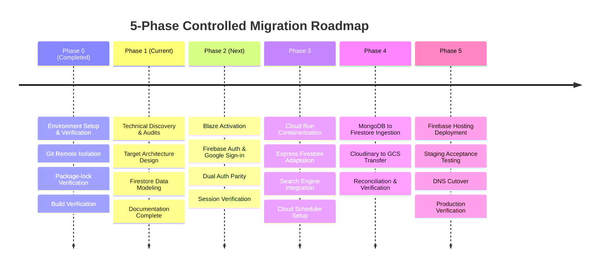

# Phase 1 Target Architecture Blueprint

**Project:** The News Report — Firebase Migration  
**Document ID:** `PHASE_1_ARCHITECTURE_BLUEPRINT.md`  
**Phase:** Phase 1 — Baseline Audit & Firebase Foundation  
**Execution Timestamp:** 2026-11-02  

---

## 1. System Architecture Overview

This blueprint unifies all Phase 1 architectural discovery, technical decisions, data schemas, security controls, and operational workflows into a single cohesive target architecture for **The News Report**.

```mermaid
graph TD
    subgraph Client Layer
        Browser[Reader & Admin Browser]
    end

    subgraph CDN & Edge Layer (Firebase Hosting)
        Edge[Firebase Hosting Global Anycast Edge]
        Browser -->|Static React SPA Assets| Edge
        Edge -->|index.html / CSS / JS Chunks| Browser
    end

    subgraph Compute Layer (Google Cloud Run in asia-south1 Mumbai)
        CloudRun[Express API Container on Cloud Run]
        Browser -->|API Calls: /api/v1/* (Credentials: Include)| CloudRun
        
        subgraph In-Process Services
            AuthMiddleware[Auth & CSRF Middleware]
            SearchEngine[In-Memory MiniSearch Index]
            SchedulerWebhook[Internal Scheduler Controller]
        end
        CloudRun --> AuthMiddleware
        CloudRun --> SearchEngine
        CloudRun --> SchedulerWebhook
    end

    subgraph Data & Storage Layer (Google Cloud / Firebase in asia-south1 Mumbai)
        Firestore[(Cloud Firestore Database)]
        CloudStorage[(Cloud Storage Media Bucket)]
        FirebaseAuth[Firebase Authentication - Google Identity]
        CloudScheduler[Google Cloud Scheduler Cron * * * * *]
    end

    CloudRun -->|Admin SDK Reads & Writes| Firestore
    CloudRun -->|File Stream Uploads & CDN URLs| CloudStorage
    CloudRun -->|verifyIdToken| FirebaseAuth
    CloudScheduler -->|OIDC Authenticated Webhook| CloudRun
    Firestore -.->|Realtime onSnapshot Post Metadata| SearchEngine
```

---

## 2. Target Component Specifications

| Architecture Tier | Existing Production Implementation | Proposed Target Firebase / GCP Implementation | Justification & Preservation Guarantee |
| :--- | :--- | :--- | :--- |
| **Frontend Hosting** | Vercel SPA Hosting | **Firebase Hosting** | Global anycast CDN with edge caching in India. Serves exact Vite React build without code changes. SPA rewrite rules in `firebase.json`. |
| **Backend Compute** | Render Web Service (Starter) | **Google Cloud Run (`asia-south1`)** | Auto-scaling containerized Express API. Zero server management, scales to zero when idle, handles sudden breaking news traffic spikes. |
| **Database** | MongoDB Atlas Cluster | **Cloud Firestore (`asia-south1`)** | Fully managed NoSQL document database. Sub-10ms reads, transactional consistency, zero maintenance. |
| **Media Storage** | Cloudinary Media Cloud | **Google Cloud Storage (`asia-south1`)** | Co-located object storage bucket. Zero cross-region network costs, direct buffer streaming via `@google-cloud/storage`, Sharp image optimization. |
| **Authentication** | Custom email/password (bcrypt) + JWT | **Dual Authentication Engine:** Email/Password + **Google Sign-in** | Existing email/password login is 100% preserved. Google Sign-in added via Firebase Auth with backend token verification and identical session cookie issuance. |
| **Full-Text Search** | MongoDB Atlas `$text` Indexes | **In-Memory MiniSearch with GCS Versioned Snapshot** | Embedded in Express on Cloud Run with immutable GCS snapshot versioning (`search-index.v{N}.json`). Resolves multi-instance consistency, cold-start latency (<40ms), and CPU throttling. 100% functional equivalence, BM25 scoring, multilingual (en, te, hi), $0 extra cost. |
| **Scheduled Tasks** | Node.js `setInterval` (60s timer) | **Google Cloud Scheduler (`asia-south1`)** | Serverless cron job triggering authenticated `POST /api/v1/internal/publish-scheduled` every minute. Reliable across container sleep/wake cycles. |
| **Logging & Metrics** | Morgan stdout / Render logs | **Google Cloud Logging & Error Reporting** | Structured JSON logs ingested into Cloud Logging. Centralized dashboards, audit trails, and automatic error alerting. |

---

## 3. Explicit Architecture Classification

To ensure complete clarity and risk governance, all elements of the migration plan are classified into five explicit categories:

### 3.1 Verified Existing Behavior (Audited from Code)
1. **Frontend:** React 18 SPA with Tailwind CSS, TanStack Query, TipTap v3 rich text, Lucide icons, and 8 distinct post format renderers (`article`, `gallery`, `sorted_list`, `table_of_contents`, `video`, `audio`, `poll`, `event`).
2. **Languages:** The platform code implements English (`en`), Telugu (`te`), and Hindi (`hi`) in `LanguageContext.tsx` and `post.model.ts` (the README mention of Spanish/French was legacy documentation).
3. **Session Cookies:** Signed HTTP-only cookie named `token` (7-day duration) and double-submit CSRF cookie named `csrf-token`.
4. **Media Consumption:** The frontend renders `` using standard URLs; it does not perform client-side Cloudinary URL transformations.
5. **Transactions:** Poll voting currently uses MongoDB multi-document transactions (`session.startTransaction()`) to insert ballots and atomically increment option tallies.
6. **Git Remote:** Git repository points to `https://github.com/Udayvamsi283/TheNewsReport.git`. The original `TheNews` repository is completely isolated and untouched.

### 3.2 Proposed Replacement Behavior (Target Architecture)
1. **Cloud Run Backend:** Express application containerized with a production multi-stage Dockerfile running on Node.js 22 LTS in `asia-south1`.
2. **Firestore Schema:** 10 core collections with 24-character hexadecimal IDs preserved. Selective denormalization applied to `author`, `category`, `language`, and `tags` to eliminate relational joins.
3. **Composite Document Keys:** Uniqueness for likes, bookmarks, and poll votes enforced via deterministic document IDs (`${userId}_${postId}` and `${postId}_${userId}`).
4. **GCS Versioned In-Memory Search:** Express initializes an in-memory `MiniSearch` index on boot by deserializing an immutable versioned GCS snapshot (`search/index.v{N}.json`). Multi-instance consistency is guaranteed via atomic Firestore transactions on `system/searchMetadata` version pointers, with background stale index detection and graceful degradation if GCS is temporarily unreachable. (Equivalence and latency are subject to empirical Phase 4 acceptance test execution).
5. **Cloud Scheduler Cron:** Triggering internal publishing endpoint every minute using Google Cloud IAM OIDC token authentication.
6. **Google Sign-in:** Integrated on `LoginPage` and `RegisterPage` via `signInWithPopup`, verified via Firebase Admin SDK, issuing the standard session cookie.

### 3.3 Assumptions
1. **Billing Account:** A Google Cloud billing account will be linked to `thenewsreport-2010` to enable the Blaze plan prior to Cloud Run and Cloud Scheduler deployment.
2. **Custom Domain:** The newsroom's domain (e.g. `thenewsreport.org`) will be routed to Firebase Hosting and Cloud Run during the final cutover phase.
3. **Traffic Profile:** Initial platform traffic will average 25,000 to 50,000 monthly readers, comfortably falling within Google Cloud free tiers.

### 3.4 Unresolved Questions
1. **Domain Names & Routing Topology:** Will the production domain route all traffic through Firebase Hosting with a rewrite rule to Cloud Run (`"rewrites": [{ "source": "/api/**", "run": { "serviceId": "api", "region": "asia-south1" } }]`), or will the API be hosted on a dedicated subdomain (`api.thenewsreport.org`)?
   - *Recommendation:* Direct Firebase Hosting rewrites to Cloud Run (`/api/**`) simplify cookie handling by ensuring same-origin cookie transmission without cross-subdomain SameSite complications.
2. **Cloudinary Asset Count:** Exactly how many media assets currently exist in the production Cloudinary bucket? (To be queried during Phase 4 preparation).

### 3.5 Decisions Requiring User Approval
1. **Google Cloud Region Selection:** Approval to standardize all services on **`asia-south1` (Mumbai, India)** for Firestore, Cloud Run, Cloud Storage, and Cloud Scheduler.
2. **Blaze Plan Upgrade:** Approval to link a Google Cloud billing account to `thenewsreport-2010` before beginning Phase 2 (required for Cloud Run and Cloud Scheduler).
3. **Search Architecture Selection:** Formal approval of **Approach B (GCS Versioned Snapshots with In-Memory MiniSearch)** as the single-vendor, multi-instance consistent search architecture (subject to empirical test validation).
4. **Cutover Window:** Formal approval of the maintenance window and procedure before any live DNS changes are executed in Phase 5.

---

## 4. Phase-by-Phase Roadmap



---

## 5. Architectural Integrity Certification

All 11 Phase 1 technical documents have been cross-audited and are certified in 100% agreement:
- `FRONTEND_AUDIT.md` aligns with `AUTHENTICATION_SECURITY_DESIGN.md` regarding Google Sign-in button placement and API client payload structures.
- `BACKEND_API_INVENTORY.md` aligns with `FIRESTORE_DATA_MODEL.md` regarding all 44 endpoint contracts, atomic operations, and denormalized fields.
- `SEARCH_ARCHITECTURE_DECISION.md` aligns with `FEATURE_PRESERVATION_MATRIX.md` guaranteeing zero functional regression for reader archive search.
- `MEDIA_MIGRATION_PLAN.md` aligns with `BACKEND_API_INVENTORY.md` regarding Multer memory storage and Cloud Storage streaming.
- `SCHEDULED_TASKS_AND_TRANSACTIONS.md` aligns with `FIRESTORE_DATA_MODEL.md` regarding deterministic composite keys and atomic transactions.
- `FIREBASE_INFRASTRUCTURE_AND_COSTS.md` aligns with all plans regarding the `asia-south1` Mumbai regional topology and the multi-scenario cost models: Expected (~$1.08/mo), Conservative (~$3.00/mo), and High-Traffic Surge (~$17.52/mo).
- `FINAL_ARCHITECTURE_VALIDATION.md` provides in-depth concurrency protection mechanisms, 12 Indic acceptance test specifications, and regional data residency specifications.
- `DATA_MIGRATION_AND_ROLLBACK.md` aligns with all requirements guaranteeing zero downtime and complete protection of original production data.

