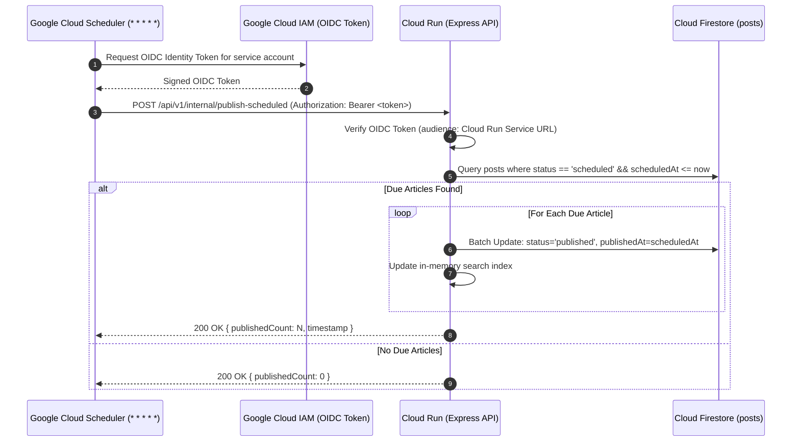

# Scheduled Tasks, Concurrency & Transactional Operations Design

**Project:** The News Report — Firebase Migration  
**Document ID:** `SCHEDULED_TASKS_AND_TRANSACTIONS.md`  
**Phase:** Phase 1 — Baseline Audit & Firebase Foundation  
**Audited Source Directory:** `backend/src/services/scheduler.service.ts`, `backend/src/controllers/engagement.controller.ts`  
**Execution Timestamp:** 2026-11-02  

---

## 1. Executive Summary

This document specifies the migration of time-triggered editorial jobs and high-concurrency transactional operations from the current Node.js runtime and MongoDB Atlas to **Google Cloud Scheduler** and **Cloud Firestore Transactions**.

Key architectural replacements:
1. **Scheduled Publishing:** The existing in-process `setInterval` background timer in `scheduler.service.ts` is fundamentally incompatible with serverless container platforms (Cloud Run scales to zero instances when idle). It is replaced with a resilient, serverless **Cloud Scheduler cron job** triggering an authenticated internal webhook.
2. **Atomic Reader Concurrency:** MongoDB multi-document transactions (`mongoose.startSession()`, `session.startTransaction()`) and compound unique indexes (`{ pollPost: 1, user: 1 }`) are replaced with native **Cloud Firestore atomic transactions** (`firestore.runTransaction()`) and **deterministic composite document IDs**.

---

## 2. Scheduled Publishing Architecture

### 2.1 Audit of Existing Implementation
- **Source Location:** `backend/src/services/scheduler.service.ts`
- **Current Mechanism:** 
  ```typescript
  export const startPostScheduler = (intervalMs = 60000) => {
    schedulerInterval = setInterval(() => {
      publishDueScheduledPosts();
    }, intervalMs);
  };
  ```
- **Why It Fails on Cloud Run:** On Google Cloud Run, instances automatically scale down to zero when there is no active HTTP traffic. When instances are idle or sleeping, background `setInterval` timers freeze. Articles scheduled for release at 08:00 AM would not publish until an arbitrary reader visits the website to wake the container.

### 2.2 Cloud Scheduler Target Architecture



### 2.3 Cloud Scheduler Specifications
- **Frequency:** Every minute (`* * * * *`).
- **Target URL:** `https://api.thenewsreport.org/api/v1/internal/publish-scheduled` (or Cloud Run direct service URL).
- **HTTP Method:** `POST`.
- **Security & Authorization:** 
  - Uses Google Cloud IAM OIDC token authentication.
  - Cloud Scheduler runs under a dedicated service account: `cloud-scheduler@thenewsreport-2010.iam.gserviceaccount.com`.
  - The endpoint verifies the token via `google-auth-library` or an internal secret header `X-Internal-Scheduler-Secret`.
- **Time Zone Handling:** 
  - All scheduling timestamps in Firestore are stored as UTC `Timestamp` values.
  - The query compares `scheduledAt <= Timestamp.now()`, ensuring accurate publication independent of server or user time zones.
- **Idempotency & Retry Safety:**
  - The query strictly filters `status == 'scheduled'`.
  - Once updated to `status == 'published'`, an article is never reprocessed.
  - If a job fails or times out, Cloud Scheduler automatically retries, picking up remaining scheduled articles safely without duplicate writes.

---

## 3. High-Concurrency Transactional Operations

Cloud Firestore provides ACID transaction guarantees through `firestore.runTransaction()`. All reads must execute before all writes within the transaction.

### 3.1 Interactive Poll Voting
- **Concurrency Problem:** A reader must vote exactly once on a poll, and the ballot must atomically increment the selected option's vote counter without race conditions.
- **Existing MongoDB Solution:** Used `session.startTransaction()`, inserted into `PollVote` (relied on MongoDB compound unique index `{ pollPost: 1, user: 1 }`), and called `Post.updateOne({ 'pollDetails.options.id': optionId }, { $inc: { 'pollDetails.options.$.votes': 1 } })`.
- **Target Firestore Transaction Design:**
  - **Deterministic Document ID:** `pollVotes/${postId}_${userId}`.
  - **Execution Flow:**
    ```typescript
    await firestore.runTransaction(async (transaction) => {
      const voteRef = firestore.collection('pollVotes').doc(`${postId}_${userId}`);
      const postRef = firestore.collection('posts').doc(postId);

      const [voteDoc, postDoc] = await Promise.all([
        transaction.get(voteRef),
        transaction.get(postRef)
      ]);

      if (voteDoc.exists) {
        throw new DuplicateVoteError('You have already submitted a vote for this poll.');
      }
      if (!postDoc.exists) {
        throw new NotFoundError('Poll post not found.');
      }

      const post = postDoc.data()!;
      const now = new Date();
      if (post.pollDetails?.startTime && now < post.pollDetails.startTime.toDate()) {
        throw new ValidationError('This poll has not opened yet.');
      }
      if (post.pollDetails?.endTime && now > post.pollDetails.endTime.toDate()) {
        throw new ValidationError('This poll has ended.');
      }

      const options = post.pollDetails?.options || [];
      const optionIndex = options.findIndex((opt: any) => opt.id === optionId);
      if (optionIndex === -1) {
        throw new ValidationError('Specified poll option does not exist.');
      }

      // Increment target option vote count in memory array
      options[optionIndex].votes = (options[optionIndex].votes || 0) + 1;

      // Atomic Writes
      transaction.set(voteRef, {
        pollPost: postId,
        user: userId,
        optionId,
        createdAt: FieldValue.serverTimestamp()
      });

      transaction.update(postRef, {
        'pollDetails.options': options
      });
    });
    ```
  - **Guarantees:** Guarantees strict single-ballot integrity, enforces schedule windows, and prevents counter drift under concurrent voter spikes.

---

### 3.2 Article Likes & Unlikes
- **Deterministic Document ID:** `likes/${userId}_${postId}`.
- **Liking an Article:**
  ```typescript
  await firestore.runTransaction(async (transaction) => {
    const likeRef = firestore.collection('likes').doc(`${userId}_${postId}`);
    const postRef = firestore.collection('posts').doc(postId);

    const [likeDoc, postDoc] = await Promise.all([
      transaction.get(likeRef),
      transaction.get(postRef)
    ]);

    if (likeDoc.exists) {
      return; // Already liked; idempotent no-op
    }
    if (!postDoc.exists) {
      throw new NotFoundError('Article not found.');
    }

    transaction.set(likeRef, {
      user: userId,
      post: postId,
      createdAt: FieldValue.serverTimestamp()
    });

    transaction.update(postRef, {
      likeCount: FieldValue.increment(1)
    });
  });
  ```
- **Unliking an Article:**
  ```typescript
  await firestore.runTransaction(async (transaction) => {
    const likeRef = firestore.collection('likes').doc(`${userId}_${postId}`);
    const postRef = firestore.collection('posts').doc(postId);

    const [likeDoc, postDoc] = await Promise.all([
      transaction.get(likeRef),
      transaction.get(postRef)
    ]);

    if (!likeDoc.exists) {
      return; // Already not liked; idempotent no-op
    }

    transaction.delete(likeRef);
    transaction.update(postRef, {
      likeCount: FieldValue.increment(-1)
    });
  });
  ```

---

### 3.3 Article Bookmarking
- **Deterministic Document ID:** `bookmarks/${userId}_${postId}`.
- **Adding a Bookmark:** Idempotent document `set`:
  ```typescript
  await firestore.collection('bookmarks').doc(`${userId}_${postId}`).set({
    user: userId,
    post: postId,
    postSnippet: {
      id: post.id,
      title: post.title,
      slug: post.slug,
      summary: post.summary,
      featuredImage: post.featuredImage,
      publishedAt: post.publishedAt,
      category: post.category
    },
    createdAt: FieldValue.serverTimestamp()
  });
  ```
- **Removing a Bookmark:** Idempotent document `delete`. Zero transaction overhead required.

---

### 3.4 Article View Counting & Throttling
- **View Deduplication:** The existing in-memory sliding-window throttling (`viewThrottler` Map in `public.controller.ts`) is maintained in Express to filter rapid refreshes.
- **Atomic Counter Update:** Incremented directly via `db.collection('posts').doc(postId).update({ views: FieldValue.increment(1) })`. This executes atomically without reading the document first, minimizing Firestore read costs.

---

### 3.5 Reader Comments & Moderation
- **Comment Creation:**
  ```typescript
  const batch = firestore.batch();
  const commentRef = firestore.collection('comments').doc();
  const postRef = firestore.collection('posts').doc(postId);

  batch.set(commentRef, {
    postId,
    post: { id: post.id, title: post.title, slug: post.slug },
    userId: user.id,
    user: { id: user.id, name: user.name, avatar: user.avatar, role: user.role },
    content: sanitizedContent,
    status: 'visible',
    createdAt: FieldValue.serverTimestamp(),
    updatedAt: FieldValue.serverTimestamp()
  });

  batch.update(postRef, {
    commentCount: FieldValue.increment(1)
  });

  await batch.commit();
  ```
- **Comment Deletion:** Decrements `commentCount: FieldValue.increment(-1)` and deletes comment document atomically.

