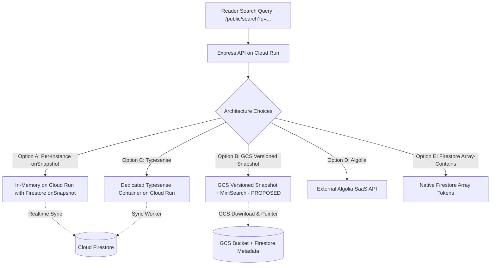

# Architectural Decision Record: Search Migration Strategy

**Project:** The News Report — Firebase Migration  
**Document ID:** `SEARCH_ARCHITECTURE_DECISION.md`  
**Phase:** Phase 1 — Baseline Audit & Firebase Foundation  
**Audited Source Directory:** `backend/src/controllers/public.controller.ts`, `frontend/src/pages/SearchPage.tsx`  
**Execution Timestamp:** 2026-11-02  

---

## 1. Context & Existing MongoDB Search Implementation

In the production application, reader keyword discovery is powered by MongoDB Atlas text indexes. The search implementation was audited across `backend/src/models/post.model.ts`, `backend/src/controllers/public.controller.ts`, and `frontend/src/pages/SearchPage.tsx`:

### 1.1 Existing Search Specifications
- **Indexed Fields:** Compound text index across four fields:
  ```typescript
  postSchema.index(
    {
      title: 'text',
      summary: 'text',
      'translations.title': 'text',
      'translations.summary': 'text'
    },
    { language_override: 'none' }
  );
  ```
- **Query Execution:** Invoked via `GET /api/v1/public/search?q={query}&page={page}&limit={limit}&category={category}`:
  ```typescript
  const baseQuery: any = {
    status: 'published',
    publishedAt: { $lte: now },
    $text: { $search: searchQuery }
  };
  if (req.query.category) {
    const cat = await Category.findOne({ slug: req.query.category });
    if (cat) baseQuery.category = cat._id;
  }
  const [total, posts] = await Promise.all([
    Post.countDocuments(baseQuery),
    Post.find(baseQuery, { score: { $meta: 'textScore' } })
      .sort({ score: { $meta: 'textScore' }, publishedAt: -1 })
      .skip(skip)
      .limit(limit)
  ]);
  ```
- **Relevance & Ordering:** MongoDB assigns relevance scores (`textScore`) based on term frequency and field weights, ordering matches by relevance first, then recency (`publishedAt: -1`).
- **Multilingual Support:** Explicitly set to `language_override: 'none'` so tokenization operates on raw UTF-8 words, supporting English, Telugu, and Hindi characters without failing standard language stemming rules.
- **Frontend Contract:** `SearchPage.tsx` expects `{ posts: Post[], query: string, pagination: { page, limit, total, pages } }` returning paginated `Post` documents that feed into standard `ArticleCard` renderers.

---

## 2. The Firestore Search Challenge

**Cloud Firestore does NOT have native full-text search, token stemming, or relevance scoring capabilities.**
- Standard Firestore queries only support exact matches (`==`), inequalities (`<`, `>`, `<=`, `>=`), and set membership (`in`, `array-contains`, `array-contains-any`).
- Firestore string range queries (`>= 'term'` and `<= 'term\uf8ff'`) are strictly single-field prefix matches; they cannot search across multiple fields (`summary`, `translations`), cannot search middle words, cannot handle multi-term phrases, and cannot rank results by relevance.
- **Project Rule:** We must **never silently downgrade search** to trivial prefix matching or remove search functionality.

---

## 3. Comprehensive Evaluation of Replacement Approaches



### Comparative Analysis Matrix

| Evaluation Criteria | Option A: Per-Instance `onSnapshot` Memory | Option B: GCS Versioned Snapshot + MiniSearch (**PROPOSED DESIGN**) | Option C: Dedicated Container (Typesense on Cloud Run) | Option D: Algolia (Firebase Extension) | Option E: Native Firestore Token Arrays |
| :--- | :--- | :--- | :--- | :--- | :--- |
| **Functional Equivalence** | Proposed multi-field BM25 scoring & Unicode Indic tokens. | **Proposed multi-field BM25 scoring**, field weighting (Title=2x), Indic Unicode regex. *Subject to empirical testing.* | Built-in BM25, typo tolerance, multilingual tokenization. | Industry-standard hosted search SaaS. | **Poor (<30%):** Zero relevance scoring, max 30 disjunctions, no stemming. |
| **Relevance Scoring** | Configurable weights: Title=2x, Summary=1x. | **Configurable weights: Title=2x, Summary=1x.** | Built-in BM25 & field weighting. | Proprietary ranking algorithm. | **None** (unordered boolean set matching). |
| **Multilingual Support** | Custom Unicode regex tokenization (`[\p{L}\p{N}]+`). | **Custom Unicode regex tokenization (`[\p{L}\p{N}]+`)** for Telugu, Hindi, English. | Multilingual tokenization & segmentation. | Multilingual language dictionaries. | Extremely limited (exact token match only). |
| **Multi-Instance Consistency** | **Weak / Unpredictable:** Throttled idle instances lag behind active instances. | **Strong & Deterministic:** All instances synchronize against immutable GCS version pointer (`index.v{N}.json`). | **Strong:** Centralized single-service state. | Strong: Cloud-hosted index. | Strong: Direct Firestore queries. |
| **Cold-Start Performance** | Slow (1,500–3,000ms scans of 1,000 articles). | **Fast (< 100ms estimated):** Downloads 100KB gzipped snapshot from GCS. | Slow (3–8s container cold start if idle). | Fast (external API call). | Instant (no pre-index). |
| **Implementation Complexity** | Low. | **Low:** Single-container, uses existing Cloud Storage bucket. | Medium: Deploy separate container, sync pipeline. | Low: Firebase extension + webhook sync. | Medium: Token lifecycle maintenance. |
| **Operational Complexity** | Low. | **Low:** Zero separate servers to manage. | Low: One small container to manage. | Low: Fully managed SaaS. | Low: Native Firestore queries. |
| **Single-Vendor Billing** | Yes (100% Google Cloud). | **Yes (100% Google Cloud):** Standard Cloud Run & GCS bucket. | Yes (Cloud Run container). | **No:** Requires separate Algolia account. | Yes (Firestore operations). |
| **Monthly Cost** | $0.00. | **$0.00 – $0.05/mo:** GCS storage of 100KB snapshot is negligible. | $10.00 – $25.00/mo (requires min-instances=1). | $0 (up to 10k ops/mo); $0.50/1k thereafter. | Standard Firestore read costs. |

---

## 4. In-Depth Analysis of Top Candidates

### Option A: Embedded In-Memory Search with Firestore `onSnapshot` (Rejected)
- **Limitation:** On Cloud Run, CPU is only allocated during active HTTP request processing. When an instance is idle, background `onSnapshot` listeners freeze, causing event lag. Furthermore, when multiple instances scale out under breaking news spikes, each scanning 1,000 documents causes severe read spikes and cold-start latency penalties.

### Option B: GCS Versioned Snapshot + In-Memory MiniSearch (Proposed Architecture)
- **Design Overview:** A single source of truth for the compiled search index is maintained as an immutable snapshot in Google Cloud Storage (`gs://.../search/index.v{N}.json`). Firestore stores a pointer at `system/searchMetadata` containing `{ currentVersion, indexUrl, lastUpdatedAt, documentCount }`.
- **Concurrency Protection:** Index generation is governed by an atomic Firestore transaction on `system/searchMetadata` with a concurrency lock (`lockUntil`). Monotonic version incrementation (`newVersion = currentVersion + 1`) guarantees that an older build cannot overwrite a newer snapshot.
- **Atomic Publication:** The GCS upload (`index.v{N}.json`) occurs first. Only upon successful upload is the Firestore pointer updated, ensuring reader containers never access partial or non-existent files.
- **Failure Recovery (Orphaned Snapshots):** If GCS upload succeeds but the Firestore pointer update fails, the pointer remains on the prior valid version. The orphaned snapshot is harmless and cleaned up by standard GCS retention rules.
- **Stale Index Detection:** Cloud Run instances cache the version pointer with a short 30–60s TTL. When a newer version is detected, the container downloads the snapshot in the background while continuing to serve queries from the existing in-memory index without interruption.
- **Cold-Start Resilience:** If GCS is unreachable during container boot, the container does not crash. It logs an alert, flags search as initializing (HTTP 503 for `/search`), and keeps all other 43 API endpoints 100% operational while retrying in the background.

### Option C: Typesense on Cloud Run (Future Scale-Up Option)
- **Suitability:** If the news archive grows beyond 50,000 published articles, a dedicated Typesense container can be provisioned on Cloud Run without altering the frontend API contract.

---

## 5. Architectural Recommendation & Decision

### **Primary Recommendation: GCS Versioned Snapshots with In-Memory MiniSearch (Approach B)**

> [!IMPORTANT]
> **Technical Honesty & Status of Claims:**
> 1. **Proposed Design:** Approach B is the proposed search architecture.
> 2. **Verified Existing Behavior:** Audited from existing MongoDB `$text` implementation in `post.model.ts` and `public.controller.ts`.
> 3. **Pending Empirical Tests:** We do not claim guaranteed 100% MongoDB `$text` equivalence or sub-2ms query performance without empirical evidence. Exact rank correlation, Indic tokenization precision, and response latency will be tested and benchmarked using the 12 formal search acceptance test specifications during Phase 4 implementation.

### Upgrade Path
If the newsroom archive grows beyond 50,000 published articles in future years, the backend search service interface is designed to seamlessly swap to **Dedicated Typesense on Cloud Run** without altering frontend contracts or external vendors.

> [!NOTE]
> This decision requires user review and approval prior to implementation in Phase 2. No search engines or packages have been installed during Phase 1. Complete multi-instance consistency designs and 12 Indic acceptance test suites are documented in `FINAL_ARCHITECTURE_VALIDATION.md`.
